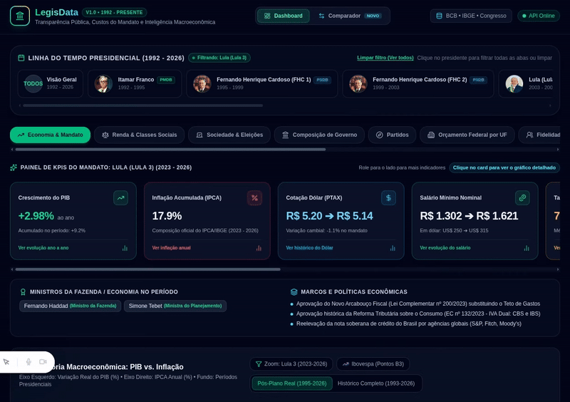

<div align="center">
  <h1>🏛️ LegisData</h1>
  <p><strong>Plataforma Cívica Independente de Transparência Política e Fiscal do Brasil</strong></p>
</div>

[](https://github.com/saulozitos/LegisData/actions/workflows/ci.yml)
[](SECURITY.md)
[](https://nextjs.org/)
[](https://fastapi.tiangolo.com/)
[](https://www.postgresql.org/)
[](https://pandas.pydata.org/)
[](https://www.docker.com/)
[](LICENSE)

---

## 🛡️ Princípio de Confiabilidade Oficial

> ### ⚠️ Nenhum dado é inventado ou preenchido com dados sintéticos.
> **Quando uma informação não é fornecida pelas APIs e relatórios oficiais, o campo permanece estritamente `null` e a interface exibe "Dado indisponível", assegurando total conformidade jurídica e técnica.**

O **LegisData** rejeita categoricamente qualquer forma de dado mockado em produção, interpolação sintética ou aproximação algorítmica não rastreável. Toda e qualquer informação disposta na plataforma possui procedência institucional pública e verificável, em estrita consonância com a **Lei de Acesso à Informação (Lei nº 12.527/2011)** e a **Constituição da República Federativa do Brasil de 1988**.

---

## 💡 Sobre o Desenvolvimento & Metodologia

> ### 🤖 Nota de Desenvolvimento (Vibe Coding)
> **Este projeto foi idealizado e arquitetado por mim, mas seu código-fonte foi integralmente desenvolvido através da metodologia de *Vibe Coding* (programação assistida por Inteligência Artificial / LLMs). A stack tecnológica utilizada (Python, FastAPI, Next.js, PostgreSQL) não faz parte do meu domínio principal. Meu foco foi a engenharia de prompts, visão do produto de dados, regras de negócio e arquitetura da informação para criar uma plataforma robusta de transparência pública.**
>
> *Autor: Saulo Araujo Campos • Licenciado sob GNU AGPLv3*

---

## 📺 Demonstração da Plataforma

<p align="center">
  
  <br>
  <em>▶️ <b>Demonstração da plataforma em execução.</b> O vídeo completo do tour do sistema está disponível nos releases do projeto.</em>
</p>

---

## 🎯 1. Propósito e Arsenal Cívico

O **LegisData** foi concebido como uma resposta técnica, visual e independente à polarização vazia e à desinformação no debate público brasileiro. Em vez de narrativas sem lastro empírico, a plataforma centraliza **dados abertos oficiais** de múltiplos órgãos de Estado para responder com rigor às principais perguntas do cidadão:

1. **Quem Paga a Conta? (Financiamento Eleitoral):** De onde veio o dinheiro que elegeu o parlamentar? Quais foram seus maiores doadores (partidos, fundos públicos e pessoas físicas)?
2. **O Basômetro (Adesão ao Governo):** O parlamentar vota alinhado com a base governista ou faz oposição sistemática nas matérias de interesse do Palácio do Planalto?
3. **Detector de Leis Inúteis (Taxa de Relevância / Score IPLE):** O congressista atua em reformas econômicas e políticas públicas estruturais ou concentra o mandato em homenagens, títulos honorários e datas comemorativas?
4. **Custo do Mandato (Cota Parlamentar - CEAP & Remuneração):** Quanto o gabinete gasta em passagens aéreas, divulgação e locações, e qual o contracheque mensal oficial do parlamentar?
5. **A Trilha do Dinheiro (Emendas Orçamentárias):** Para onde vão as emendas individuais, de bancada, de comissão e do relator-geral? Classificação por localidade, tipo de autor e estágio de desembolso (Orçado, Empenhado e Pago).
6. **Raio-X Judicial & Ficha Limpa (DataJud / CNJ):** Auditoria de certidões cíveis e criminais do TSE, STF, STJ e tribunais regionais com numeração CNJ de 20 dígitos e metadados oficiais das Tabelas Processuais Unificadas (TPU), à luz da Lei Complementar nº 135/2010.
7. **Macropolítica e Indicadores Reais:** Cruzamento histórico da atuação política com PIB real, inflação (IPCA), taxa Selic, câmbio USD, salário mínimo, desigualdade (Gini), classes de renda (PNAD Contínua), desmatamento (INPE/PRODES) e violência (IPEA/FBSP).
8. **Linha do Tempo Presidencial (1992 - Presente):** Raio-X comparativo dinâmico de todos os mandatos presidenciais com métricas fiscais, monetárias e sociais ano a ano, unificado por serviço centralizado.
9. **Cidadania Ativa & Votação Direta:** O cidadão não apenas fiscaliza o passado, mas intervém no presente. A plataforma lista consultas públicas e enquetes oficiais em tramitação em tempo real no Congresso Nacional (e-Cidadania e e-Democracia), permitindo votar diretamente nas instâncias legislativas.

---

## 🏛️ 2. Fontes Abertas Oficiais

Todos os dados são coletados de forma rastreável por extratores dedicados (`User-Agent: LegisDataBot/1.0`), estritamente fundamentados na **Lei de Acesso à Informação (Lei nº 12.527/2011)**. Consulte a especificação exaustiva em [`docs/FONTES_URLS_E_APIS.md`](docs/FONTES_URLS_E_APIS.md).

| Órgão / Instituição | Dados Coletados | Endpoint / Repositório Oficial |
| :--- | :--- | :--- |
| **Câmara dos Deputados** | Deputados, mandatos, presenças em plenário, votos nominais, comissões, proposições, salários mensais e despesas da cota (CEAP) | `dadosabertos.camara.leg.br/api/v2` e portal oficial |
| **Senado Federal** | Senadores, mandatos, proposições legislativas, sessões deliberativas, comissões e totais de votações secretas | `legis.senado.leg.br/dadosabertos` |
| **TSE (Justiça Eleitoral)** | Prestações de contas eleitorais, doações de campanha, certidões de candidatura e declarações de bens | Portal Dados Abertos TSE (`dadosabertos.tse.jus.br`) |
| **DataJud (CNJ)** | Metadados processuais oficiais (TPU), classes, assuntos, órgãos julgadores e datas de distribuição | API Pública do CNJ (`api-publica.datajud.cnj.jus.br`) |
| **Portal da Transparência (CGU)** | Emendas orçamentárias (individuais, bancadas, comissões, relator) e transferências federais por UF | `portaldatransparencia.gov.br/download-de-dados` |
| **Banco Central do Brasil (BCB)** | Séries temporais de IPCA, taxa Selic, Câmbio USD PTAX e Dívida Líquida/PIB | Sistema Gerenciador de Séries Temporais (SGS) |
| **IBGE (SIDRA e Microdados)** | Contas Nacionais (PIB real), inflação (IPCA), desemprego e classes de salário mínimo da PNAD Contínua | Banco SIDRA e microdados da PNAD Contínua |
| **INPE** | Desmatamento anual consolidado na Amazônia Legal e Cerrado | Projeto PRODES / Plataforma TerraBrasilis |
| **IPEA & FBSP** | Séries históricas de segurança pública e taxas de homicídio | Atlas da Violência / IpeaData |

---

### 📌 Notas Oficiais sobre Cobertura e Limitações Institucionais

1. **Presença em Plenário da Câmara dos Deputados (Nota de 2019):**
   > O portal oficial da Câmara dos Deputados (`camara.leg.br`) **não possui relatórios de presença para o ano de 2019**. O serviço oficial de publicação de presenças por sessão deliberativa teve início em **2020**. Por isso, em cumprimento irrestrito ao *Princípio de Confiabilidade Oficial*, os dados de presença de 2019 permanecem estritamente `null` no banco de dados e a interface exibe "Dado indisponível". Para os anos de **2020 a 2026, 100% dos dados de presença estão baixados e carregados** (328.715 dias de sessões).
2. **Votações Secretas no Senado Federal:**
   > Por determinação constitucional e regimental, em escrutínios secretos (como apreciação de autoridades e vetos presidenciais), o Senado Federal **não disponibiliza o voto nominal individual** de cada senador em sua API de Dados Abertos. Nesses casos, o LegisData exibe fidedignamente o placar agregado oficial apurado na urna (`Sim`, `Não`, `Abstenção`), omitindo o votante individual e exibindo um banner oficial de esclarecimento ao cidadão.
3. **Remuneração Parlamentar:**
   > A Câmara dos Deputados publica o contracheque mensal de seus parlamentares desde 2019 (100% extraído e carregado no banco: 39.263 folhas salariais). O Senado Federal não possui endpoint público estruturado para folha salarial nominal individualizada; portanto, seus campos permanecem `null` exibindo "Dado indisponível".
4. **Emendas Orçamentárias Coletivas e Institucionais:**
   > Emendas do tipo "Bancada Estadual", "Comissões" e "Relator-Geral" não pertencem a um parlamentar individual. A API do LegisData categoriza essas emendas pelo tipo institucional (`BANCADA_ESTADUAL`, `COMISSAO_INSTITUCIONAL`, `RELATOR_GERAL`), com rotulagem amigável que explica ao cidadão que o recurso decorre de deliberação coletiva.

---

## ⚖️ 3. Conformidade e Salvaguardas Jurídicas — Integração DataJud / CNJ

A utilização da API Pública do Conselho Nacional de Justiça (DataJud) pelo **LegisData** é pautada pelo estrito cumprimento da ordem jurídica brasileira, da **Portaria CNJ nº 160/2020**, da **Resolução CNJ nº 332/2020** e da **Lei Geral de Proteção de Dados (LGPD — Lei nº 13.709/2018)**:

1. **Finalidade Estritamente Pública e Cívica:** O consumo de dados judiciais visa exclusivamente o controle social, a transparência pública e a aferição da idoneidade de candidatos e ocupantes de cargos públicos eletivos, em harmonia com a Lei da Ficha Limpa (LC nº 135/2010) e o art. 5º, XXXIII da Constituição Federal.
2. **Presunção Constitucional de Inocência (Art. 5º, LVII da CF/88):** A existência de processo judicial, inquérito ou termo circunstanciado em tramitação **não implica condenação definitiva nem presunção de culpabilidade**. O LegisData restringe-se a exibir metadados objetivos públicos (número de processo CNJ, tribunal de origem, classe e assunto oficial conforme as Tabelas Processuais Unificadas - TPU) sem qualquer juízo de valor condenatório subjetivo.
3. **Vedações Expressas:** Em cumprimento às normas da API Pública do CNJ, é **terminantemente vedada** a utilização destes dados para fins de pontuação de crédito comercial (*credit scoring*), análise discriminatória de perfil de risco privado ou qualquer profiling que viole direitos fundamentais.
4. **Segredo de Justiça e Sigilo Processual:** Processos sob sigilo ou segredo de justiça deferido pelo Poder Judiciário não constam na API Pública do DataJud e **jamais são acessados, extraídos ou exibidos** pela plataforma.
5. **Autenticidade Rastreável:** As informações refletem os registros de 20 dígitos padronizados pela Resolução CNJ nº 65/2008, com cache local idempotente para evitar sobrecarga nas instâncias judiciárias.

---

## 🔒 4. Segurança, Infraestrutura e Conformidade

A infraestrutura e o pipeline de CI/CD do LegisData foram endurecidos contra ameaças cibernéticas:

- **Isolamento de Rede:** no `docker-compose.yml` de produção, PostgreSQL e backend não publicam portas no host; a comunicação ocorre pela rede interna do Compose. O frontend escuta em `127.0.0.1:3000` para ser exposto por proxy reverso com terminação TLS e cabeçalhos HSTS.
- **Fail-Fast de Credenciais:** a aplicação recusa iniciar sem senha de banco explícita configurada no ambiente. O modo SSL do banco é parametrizável (`DB_SSLMODE`).
- **Contêineres Endurecidos:** backend e frontend executam sob usuário não-privilegiado (`appuser`), com `no-new-privileges`, `cap_drop: ALL`, healthchecks e limites de recursos.
- **CI/CD Endurecido (GitHub Actions):** Pipeline automatizado contendo formatação (`black`, `isort`), linters (`flake8`, `eslint`), checagem de tipos (`mypy`, `tsc`), segurança estática (`bandit`, `pip-audit`, `npm audit`, CodeQL e Trivy) e esteira completa de testes (`pytest` e `vitest`).
- **Divulgação Responsável:** Política formal detalhada em [SECURITY.md](SECURITY.md).

---

## 🛠️ 5. Stack Tecnológica

- **Frontend:**
  - **Next.js 16 (App Router & Turbopack)** com TypeScript rigoroso.
  - **Tailwind CSS v4** com design system HSL escuro e alta fidelidade visual.
  - **Zod** para validação de esquemas e respostas da API em runtime.
  - **Recharts 3.10** para gráficos estatísticos, séries temporais e comparadores.
  - **Lucide React** para iconografia técnica.
- **Backend:**
  - **Python 3.11+** com **FastAPI** assíncrono.
  - **Pydantic v2** com `pydantic-settings` para validação estrita de contratos.
  - **SQLAlchemy 2.0** com connection pooling resiliente.
  - **Serviço Presidencial Unificado** (`presidential_service.py`) como fonte única de verdade temporal e política.
  - **Gunicorn & Uvicorn Workers** em produção.
- **Banco de Dados:**
  - **PostgreSQL 16** com mais de 1,4 milhão de registros relacionais oficiais indexados.
  - **Prisma Schema** validado e sincronizado com os modelos relacionais.
- **Qualidade & DevOps:**
  - **Docker Compose** para orquestração segura.
  - **Testes Automatizados:** `pytest` (backend e ETL isolados) e `vitest` (frontend).

---

## 🚀 6. Instalação e Execução Local

### Pré-requisitos
- **Git**
- **Docker** e **Docker Compose**
- **Python 3.11+**
- **Node.js 22+**

### Passo 1: Clonar o Repositório e Configurar o `.env`
```bash
git clone https://github.com/saulozitos/LegisData.git
cd LegisData

# Copie o arquivo de exemplo e defina uma senha forte
cp .env.example .env
```

Edite o `.env` garantindo que a variável `POSTGRES_PASSWORD` esteja preenchida:
```env
POSTGRES_USER=politica_user
POSTGRES_PASSWORD=sua_senha_secreta_aqui
POSTGRES_DB=politica_db
POSTGRES_PORT=5432
POSTGRES_SERVER=localhost
ENVIRONMENT=development
```

### Passo 2: Subir o PostgreSQL Local via Docker
```bash
make up-db
```
*(Ou diretamente: `docker compose up -d postgres`)*

### Passo 3: Configurar o Ambiente Virtual Python
```bash
python3 -m venv .venv
source .venv/bin/activate
pip install --upgrade pip
pip install -r backend/requirements.txt -r backend/requirements-dev.txt
pip install -r etl/requirements.txt -r etl/requirements-dev.txt
```

### Passo 4: Executar a Carga Inicial do Banco de Dados
```bash
make run-load-db
```
*O pipeline executará as migrações, ingerindo séries históricas, parlamentares, cota CEAP, emendas, processos e doações do TSE.*

Cargas complementares de assiduidade e remuneração oficiais:
```bash
python etl/run_etl.py --load-presenca
```

### Passo 5: Iniciar o Backend (FastAPI)
```bash
make backend-dev
```
A API estará em execução em **`http://localhost:8000`**.
- Swagger UI: `http://localhost:8000/docs`
- ReDoc: `http://localhost:8000/redoc`

### Passo 6: Iniciar o Frontend (Next.js)
Em outro terminal:
```bash
cd frontend
npm install
npm run dev
```
O portal estará disponível em **`http://localhost:3000`**.

---

## 🧪 7. Esteira de Validação Local (CI Quality Gate)

Para validar localmente todo o código antes de submeter commits ou Pull Requests:

```bash
# Executa todos os testes, linters, tipagem e build em modo fail-fast
make ci
```

Você também pode executar as validações de forma granular:

| Comando | Descrição |
| :--- | :--- |
| `make format` | Autoformatação de código Python com `black` e `isort` |
| `make lint` | Análise estática com `flake8` (Python) e `eslint` (TypeScript) |
| `make typecheck` | Checagem de tipos com `mypy` e `tsc --noEmit` |
| `make security` | Auditoria estática de vulnerabilidades com `bandit` e `pip-audit` |
| `make test` | Execução das suítes de testes automatizados (`pytest` e `vitest`) |
| `make build-frontend` | Validação de compilação de produção do Next.js |

---

## 📡 8. Principais Endpoints da API RESTful

| Método | Endpoint | Descrição |
| :--- | :--- | :--- |
| `GET` | `/api/v1/politicians` | Listagem e busca de políticos (filtro por mandato presidencial `mandate_id`, cargo, partido, UF) |
| `GET` | `/api/v1/politicians/{id}` | Dossiê completo: perfil, Basômetro real, relevância legislativa e assiduidade |
| `GET` | `/api/v1/politicians/{id}/doacoes` | Prestações de contas eleitorais e Top Doadores oficiais (TSE) |
| `GET` | `/api/v1/politicians/{id}/ceap` | Cota parlamentar: despesas por categoria e fornecedores contratados |
| `GET` | `/api/v1/politicians/{id}/emendas` | Emendas parlamentares individuais vinculadas |
| `GET` | `/api/v1/politicians/{id}/certidoes` | Certidões judiciais cíveis e criminais enriquecidas via DataJud / CNJ |
| `GET` | `/api/v1/emendas/resumo` | Visão macro das emendas: totais pagos/empenhados, divisão por tipo de autor e áreas |
| `GET` | `/api/v1/emendas/localidade/{localidade}` | Consulta territorial de emendas por município ou UF de destino |
| `GET` | `/api/v1/emendas/autor/{autor}` | Consulta de emendas por deputado, senador, comissão, bancada estadual ou relator |
| `GET` | `/api/v1/economic/annual-summary` | Séries macroeconômicas oficiais (PIB, IPCA, Dólar, Selic, Salário Mínimo) |
| `GET` | `/api/v1/analytics/mandates-performance` | Desempenho consolidado por mandato presidencial |
| `GET` | `/api/v1/analytics/compare-mandates` | Comparação normalizada de mandatos presidenciais ($T_0 \dots T_n$) |
| `GET` | `/api/v1/analytics/social-classes` | Distribuição de classes por salário mínimo baseada em microdados da PNAD Contínua |
| `GET` | `/api/v1/analytics/federal-transfers` | Repasses federais diretos da União por Unidade da Federação |
| `GET` | `/api/v1/cidadania/consultas` | Consultas públicas e enquetes ao vivo (Senado e Câmara) |
| `GET` | `/api/v1/legislative/ranking/authors` | Produtividade legislativa com Score IPLE (ponderação por relevância formal) |
| `GET` | `/api/v1/legislative/calendar` | Calendário deliberativo anual com votações nominais e apuração de votos secretos |

---

## 📚 9. Documentação Complementar do Repositório

- [`docs/FONTES_URLS_E_APIS.md`](docs/FONTES_URLS_E_APIS.md): Registro exaustivo de 100% das URLs, endpoints, parâmetros e periodicidade de todas as fontes.
- [`docs/AUDITORIA_PROPOSICOES.md`](docs/AUDITORIA_PROPOSICOES.md): Auditoria técnica sobre proposições do Senado e caso do deputado Duda Ramos.
- [`docs/CONFERENCIA_PNAD.md`](docs/CONFERENCIA_PNAD.md): Comparativo metodológico dos microdados da PNAD Contínua com as publicações do IBGE (SIS).
- [`docs/SERIES_CURADAS_E_FONTES.md`](docs/SERIES_CURADAS_E_FONTES.md): Rastreamento de fontes oficiais e justificativas para séries históricas institucionais.
- [`docs/DECISOES_E_DUVIDAS_PENDENTES.md`](docs/DECISOES_E_DUVIDAS_PENDENTES.md): Registro de pontos em aberto para validação e direcionamento do mantenedor.
- [`docs/PENDENCIAS_E_LACUNAS.md`](docs/PENDENCIAS_E_LACUNAS.md): Relatório de status e resolução de todas as pendências identificadas no ciclo de refatoração.

---

## 📜 10. Licença e Transparência

Este projeto é software livre licenciado sob a [GNU Affero General Public License v3.0 (GNU AGPLv3)](LICENSE). Copyright (c) 2026 Saulo Araujo Campos. Todas as informações exibidas constituem patrimônio público acessível sob os ditames da Lei nº 12.527/2011 (LAI) e da legislação eleitoral brasileira.
