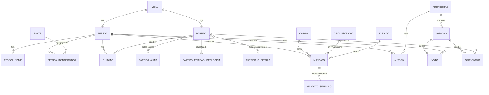

# Plano de Refatoração do Banco de Dados — LegisData

Data da análise: 2026-10-15. Escopo: nova modelagem PostgreSQL, ETL que baixa, lê e popula o banco, e migração de tudo que hoje está "solto" no código.

Este documento é um plano, não uma implementação. Nenhuma tabela ou código foi alterado.

---

## 0. Decisões registradas (2026-10-15)

| # | Decisão |
|---|---------|
| D1 | Cadastrar no banco os **cargos estaduais** (governador, vice, secretário, deputado estadual, deputado distrital) junto com os federais. **Não** popular eleitos estaduais/municipais. Municipais (prefeito, vereador) ficam para depois. |
| D2 | Chaves `bigint identity` + `uid uuid` público. |
| D3 | **Não armazenar CPF.** Nenhuma tabela nova tem coluna de CPF; o tipo de identificador não aceita `CPF`. |
| D4 | Desenvolvimento e testes exigem Postgres (container). |
| D5 | Imagens como arquivo em volume do servidor. |
| D6 | Nomes de tabelas e colunas em português, `snake_case`. |
| D7 | **Opção (a):** remover os indicadores digitados à mão de `seed_executivo.py`. Cada indicador só volta ao banco com fonte oficial verificável e rastreada em `etl.fonte`; a pesquisa de aprovação popular só volta se houver fonte segura. Mapear essas fontes é pré-requisito da Entrega 3. |
| D8 | Janela histórica: **toda a janela (séries econômicas, mandatos, votos e cálculos) começa em 1995-01-01**, primeiro ano completo após o Plano Real (julho de 1994). Decidido em 2026-10-15 para simplificar dados e cálculos. **Confirmado em 2026-10-15:** a linha presidencial exibida começa em Fernando Henrique Cardoso, em 1995-01-01, sem Itamar Franco (aplicar na Entrega 3, junto com o corte das séries econômicas). |
| Processo | Uma branch por entrega; garantir que tudo funciona; **pedir validação local da UI antes de abrir PR**. |

---

## 0.1 Status das entregas

| Entrega | Escopo | Estado |
|---------|--------|--------|
| 1 | Alembic, Postgres nos testes, schemas `ref/core/etl/param`, ponte legado→core, `/parties` | PR #36 |
| 2 | Schema `leg` (proposição, autoria, votação unificada, voto, orientação, presença particionada), ponte legado→leg, pesos do IPPM em `param`, IPPM e linha do tempo da bancada lendo `core`/`leg` | Em validação (branch `refactor/db-entrega-2-legislativo`, empilhada sobre a Entrega 1) |
| 2b | Cobertura: status real, todas as proposições desde 1995, autores sem pessoa, IPPM por período e cadeiras de todos os períodos (Câmara) | Em validação (branch `refactor/db-entrega-2b-cobertura`) |
| 2c (pendente) | Endpoints de `legislative.py`, votos/proposições em `politicians.py`, Basômetro, deliberações e `legislative_scoring.py` ainda leem o schema legado; unificar os três conjuntos de pesos divergentes do IALP/IPPM | A fazer |
| 3 | Economia e Executivo, corte em 1995, remoção de `seed_executivo.py`, novo ETL | A fazer |

### Entrega 2b — cobertura de proposições e de cadeiras (2026-10-15)

Decisões do mantenedor: extrair o status real; reduzir o peso das assinaturas de apoio a PEC (valor escolhido: **0,05**, ou seja 0,15 ponto por assinatura contra 0,6 antes) e expor a contagem à parte; manter o IALP v2 com veto total a 0,8; alinhar os períodos; registrar todas as proposições, inclusive as sem autor identificado.

**O que foi construído (ETL em estágios: baixar → staging → merge em SQL):**
- `camara_bulk_extractor` + `camara_bulk_loader` + `etl.merge_camara_bulk()`: CSV anuais de proposições e autores da Câmara, 1995–2026. A situação da tramitação vem de `ref.situacao_camara` (dado, não código); situação sem mapa vira `etl.rejeito` (nada de padrão silencioso). Hipótese registrada: "Aguardando Apreciação do Veto" é tratada como veto parcial.
- `core.entidade`: autores que não são pessoas (Poder Executivo, comissões, Mesa, lideranças, sociedade civil...) são registrados. Senadores citados só por nome ficam na autoria com nome, UF e partido da fonte (sem identidade por nome) e pontuam para o partido.
- `camara_historico_extractor` + `etl.merge_camara_historico()`: posse, saída, licença, suplência e troca de partido de cada deputado → `core.mandato`, `core.mandato_situacao` e `core.mandato_partido` (partido que ocupa a cadeira em cada dia). Titulares e suplentes entram igualmente.
- IALP v3 (= v2 + novos tipos de iniciativa e `SEM_INFORMACAO` = 1,0 + peso de apoio de quórum em PEC).
- UI do Raio-X: três abas (**Comparar**, **Tabela**, **Evolução**) e a Matriz de Eficiência como última parte da página, recolhida. Endpoint `GET /parties/ippm-evolucao` (IPPM ano a ano, 2003 em diante). O ranking de um ano caiu de 4–10 s para ~1,5 s (pesos por junção, `param.vw_peso_vigente`).
- Taxa de eficácia só sobre **projetos** (decisão do mantenedor): `ref.tipo_proposicao.categoria` separa PROJETO de PEDIDO (REQ, INC, RIC, RCP, RQC). Os pedidos seguem pontuando no IPPM (peso 0,1), mas saem do denominador da eficácia, que passou de ~0,5% para 2–8% em 2024.
- IPPM: proposições e votações filtradas pelo ano selecionado, no mesmo período das cadeiras-dia; fidelidade sem votação vira "indisponível" (antes aparecia 100%).

**Diagnóstico de cobertura (fonte: CSV anuais, 1995–2026):**
- 907.668 documentos legislativos; 357.260 são iniciativas com peso na metodologia (PL, PEC, PLP, MPV, PDL/PDC, PRC, REQ, RIC, INC...). Os demais (pareceres, emendas, substitutivos, redações finais: 132 tipos) são trâmites internos e ficam contados em `etl.verificacao`, sem pontuar.
- 1.831.883 linhas de autoria: 757 mil proposições com deputado identificado por id; 1.133 entidades; senadores só por nome.
- Lacunas que continuam abertas: (1) proposições que nascem no Senado e nunca passam pela Câmara (API do Senado ainda não integrada); (2) cadeiras do Senado antes de 2023; (3) cadeiras da Câmara de 1995 a 2002: a API só publica eventos de mandato a partir da 52ª legislatura (2003). Nesses períodos o IPPM não é calculado e o ranking avisa; alternativas: eleitos de 1994/1998 pelo TSE como bancada aproximada (marcada como aproximada) ou fonte documental da Câmara.

### Decisão: conjunto único de pesos do IALP (2026-10-15)

O código tinha quatro conjuntos divergentes de pesos para tipo, autoria e tramitação: o `CASE WHEN` do SQL do IPPM, `legislative_scoring.py`, os dicionários `PESO_*` de `party_productivity_service.py` (código morto) e valores soltos no perfil do parlamentar (`politicians.py`). Decisão do mantenedor:

1. Tipo, autoria e tramitação conforme `docs/METODOLOGIA_ATIVIDADE_LEGISLATIVA.md`.
2. Veto parcial = 1,5; veto total = 0,8.
3. Decreto presidencial e lei delegada = 1,0.
4. Sem valor padrão silencioso (`*`): tipos e status são explícitos e estritos; falta de peso é erro.
5. `SANCIONADO` (que não existe no status real dos dados) é removido.

Implementação: metodologia `IALP` v2 em `param.peso` (migração 0008); `param.peso_de()` falha quando falta peso; `app/services/ialp_pesos.py` carrega os pesos no Python; `leg.vw_autoria_pontuada` calcula a pontuação em SQL. Os `CASE WHEN`, os dicionários e as metodologias v1 foram removidos.

Pendências de metodologia (Entrega 3): a classificação de blocos de governo está fixa em "Lula 2023" (`get_party_bloc_alignments`) e o IPPM soma proposições de todo o histórico mas divide pelas cadeiras-dia de um único ano. Observação sobre os dados: as 2.707 proposições carregadas estão todas como `EM_TRAMITACAO`; a extração não traz o status real, então os pesos de tramitação e a taxa de eficácia ainda não têm efeito.

---

## 1. Resumo executivo

1. **A direção está certa.** Banco como fonte única da verdade, ETL em três estágios (baixar, ler, popular) e regras de cálculo próximas dos dados.
2. **Duas das quatro tabelas propostas precisam de ajuste.**
   - `nome` não deve ser uma tabela de identidade. Nome não identifica ninguém (homônimos reais já aparecem nos dados: Átila Lira pai e filho, Rodrigo Pacheco deputado e senador). A raiz deve ser `pessoa`, e os nomes viram atributos dela (`pessoa_nome`).
   - `politico` como cruzamento de nome + partido + cargo não funciona, porque partido e cargo mudam com o tempo. A ligação correta é por **períodos**: `filiacao` (pessoa × partido × período) e `mandato` (pessoa × cargo × circunscrição × período). "Quem é aquele político" passa a ser uma **view** (`vw_politico`) montada a partir dessas tabelas.
3. **`partido` e `cargo` ficam como você propôs**, com acréscimos: histórico de siglas e fusões, posição ideológica com fonte, imagem como arquivo rastreável, e cargo com esfera, poder e regras do mandato. Cargos de prefeito e vereador ainda não existem no modelo atual.
4. **Existe muito dado solto no código** (inventário na seção 5): cores e logos de partidos, escala ideológica, pesos do IALP duplicados em Python e em SQL, glossários, mapas de UF, séries do BCB, e um `seed_executivo.py` com números digitados à mão. Tudo isso vai para tabelas.
5. **A API lê JSON do disco em 30+ pontos** (`analytics.py`, `politicians.py`, `economic.py`, `emendas.py`). Depois da refatoração a API só lê o banco; o JSON vira apenas arquivo bruto do ETL.
6. **O banco pode fazer bem mais do que faz hoje**, mas não tudo. A seção 6 separa o que é possível, o que é recomendável e o que não deve ir para o banco (baixar das APIs, scraping de HTML, grafo de coautoria, decisão de identidade ambígua).
7. **Estratégia de migração: reconstruir, não converter.** Quase tudo vem de fontes públicas reprocessáveis. Criamos o schema novo ao lado do antigo, populamos pelo novo ETL, reconciliamos com o antigo e trocamos endpoint por endpoint. Os poucos dados que não são reprocessáveis (curadoria manual) são inventariados e exportados antes.
8. **Pré-requisito técnico que muda a infraestrutura de testes:** os recursos que fazem valer a pena (restrições de não sobreposição, views materializadas, `pg_trgm`) só existem em PostgreSQL. A suíte atual usa SQLite em memória. A CI precisa passar a rodar contra um Postgres real.

---

## 2. Diagnóstico do estado atual

Fatos verificados no código (arquivo:linha quando relevante).

### 2.1 Modelo de dados

| Problema | Onde | Consequência |
|----------|------|--------------|
| Migração por DDL manual dentro do código de startup | `backend/app/main.py` (`run_db_migrations`, `ALTER TYPE`, `ADD COLUMN IF NOT EXISTS`) | Sem versionamento, sem rollback, sem ordem garantida. Falha não derruba o boot. Não roda na suíte (SQLite). |
| Enums Postgres para domínios que crescem | `CargoPoliticoEnum`, `TipoProposicaoEnum`, `StatusTramitacaoEnum` | Cada valor novo exige `ALTER TYPE`. Já causou os commits `669d036` e `c7c39d5`. `CargoPoliticoEnum` não tem prefeito, vereador nem suplente. |
| Colunas em camelCase com aspas misturadas com snake_case | `politicos."nomeCivil"` vs `votacoes_proposicao.data_hora` | Quem escreve SQL cru precisa de aspas. Inconsistente. |
| Tabelas de votação duplicadas | `sessoes_votacao` + `votos_parlamentares` **e** `votacoes_proposicao` + `votos_nominais` + `orientacoes_partidarias` | Duas representações do mesmo fato. Consultas e serviços divergem. |
| Texto onde deveria haver chave estrangeira | `historico_mandatos.party_acronym`, `orientacoes_partidarias.partido_bancada` (PK de 50 chars), `presidential_mandates.partido`, `membros_gabinete.occupant_name`, `proposicoes_autores.author_name`, `resumos_macroeconomicos_anuais.dominant_president_name` | Renomear uma sigla quebra o histórico. Não há integridade referencial. |
| JSON guardado em coluna de texto | `sessoes_votacao.orientacoesBancadas` (Text), `politicos.redesSociais` (JSON) | Não consultável com índice, sem esquema. |
| Cópia derivada gravada como tabela | `historico_mandatos` é recalculada por `sync_mandate_history` a partir de `mandatos` + `membros_gabinete` | Pode ficar defasada. Deveria ser derivada por SQL. |
| Identidade de pessoa em uma só tabela larga | `politicos` tem 5 identificadores externos, biografia, contato, redes sociais | Sem rastreio de fonte por identificador. Sem nomes alternativos. Quem é ministro sem ser parlamentar é guardado como texto. |
| UUID v4 em tabelas de milhões de linhas | `votos_parlamentares`, `votos_nominais`, `registros_presenca` | Índices maiores e inserção mais lenta que `bigint`. |
| Sem restrição temporal | `filiacoes_partidarias`, `mandatos` | Nada impede duas filiações simultâneas ou mandatos sobrepostos. |

### 2.2 Dados soltos no código

Ver inventário completo na seção 5. Os mais graves:

- `PESO_TIPO`, `PESO_STATUS`, `PESO_AUTORIA`, `MULTIPLICADOR_TRAMITACAO` existem como dicionários Python **e** como `CASE WHEN` literal dentro do SQL de `party_productivity_service.py` e `legislative_scoring.py`. Mudar um peso exige alterar dois lugares.
- `ESCALA_IDEOLOGICA_PADRAO` (`iple_service.py:23`) é classificação editorial sem fonte rastreável no dado.
- `backend/seed_executivo.py` (209 linhas) tem indicadores mensais digitados à mão por mandato. Isso contradiz o princípio documentado em `docs/FONTES_URLS_E_APIS.md` ("nenhum dado inventado, sintético ou estimado") porque não há rastreio de fonte por linha.
- `PRESIDENT_PHOTOS`, `PARTY_COLORS` e `OFFICIAL_PARTY_LOGOS` apontam para arquivos locais e para URLs da Wikimedia (hotlink frágil, sem controle de licença).

### 2.3 ETL

- `etl/pipelines/db_loader.py` tem 2.214 linhas e mistura leitura de arquivo, regra de negócio e escrita linha a linha via ORM.
- Etapas são acopladas por arquivos JSON em `etl/data/processed/` (cerca de 50 MB), sem manifesto, sem checksum e sem registro de qual versão da fonte gerou cada arquivo.
- Os extractors já usam `HttpClient` com retry (bom) e `run_etl.py` isola falhas por etapa (bom). Esses dois pontos são mantidos.
- Dois utilitários de nomes duplicados e independentes: `etl/utils/names.py` e `backend/app/core/names.py`.
- O cron (`cron_daily_consolidation.py`) já registra execuções em `log_execucao_cron`, mas só cobre a consolidação, não a extração.

### 2.4 API

- `politicians.py` (1.939 linhas), `legislative.py` (1.580) e `analytics.py` (1.173) misturam rota, regra de negócio, leitura de JSON e SQL cru.
- Parte do cálculo já é SQL puro dentro de `text(...)` (IALP, IPPM, fidelidade). Isso comprova que o banco consegue fazer o trabalho, e que ele só precisa ser formalizado em views versionadas.

---

## 3. Crítica das ideias propostas e modelo refinado

### 3.1 Tabela `nome`

**Proposta original:** uma tabela só com o nome do político; CPF, data de nascimento etc. amarrados a ela.

**Problema:** nome não é identidade. A mesma pessoa tem nome civil, nome eleitoral, nome parlamentar e variações de grafia entre fontes. Pessoas diferentes têm o mesmo nome. Se `nome` for a raiz, cada homônimo vira um conflito.

**Refinamento:** a raiz é `pessoa`. Os nomes viram uma tabela filha com tipo, fonte e vigência. CPF, data de nascimento, ids da Câmara, do Senado e do TSE ficam na pessoa ou em uma tabela de identificadores.

```
pessoa                  1 ─── N  pessoa_nome
  │                              (civil, eleitoral, parlamentar, historico, grafia_fonte)
  ├── 1 ─── N  pessoa_identificador   (CPF, id Câmara, id Senado, SQ_CANDIDATO TSE...)
  ├── 1 ─── N  filiacao ─── N:1 ─ partido
  └── 1 ─── N  mandato  ─── N:1 ─ cargo
```

### 3.2 Tabela `partido`

Mantida, com acréscimos:

- `partido` guarda o estado atual (sigla vigente, nome, número eleitoral, datas de fundação e extinção).
- `partido_alias` guarda siglas antigas e grafias de fonte (PMDB→MDB, PFL→DEM→UNIÃO, `PC do B`/`PCdoB`/`PCDOB`). Substitui `PARTY_SIGLA_ALIASES`.
- `partido_sucessao` registra fusões e incorporações (muitos para muitos, com data e tipo). O modelo atual só permite um sucessor.
- `partido_posicao_ideologica` guarda a posição ideológica **com fonte, ano e metodologia**. Ideologia é uma classificação editorial; sem fonte vira opinião do código.
- Imagem: `partido.logo_midia_id` aponta para a tabela `midia` (seção 3.6). Cor: `partido.cor_hex`.

### 3.3 Tabela `cargo`

Mantida, e ampliada para ser a fonte de verdade que hoje é um enum:

| Coluna | Função |
|--------|--------|
| `codigo` | `PRESIDENTE`, `VICE_PRESIDENTE`, `GOVERNADOR`, `VICE_GOVERNADOR`, `PREFEITO`, `VICE_PREFEITO`, `SENADOR`, `DEPUTADO_FEDERAL`, `DEPUTADO_ESTADUAL`, `DEPUTADO_DISTRITAL`, `VEREADOR`, `MINISTRO_DE_ESTADO`, `SECRETARIO_ESTADUAL`, `SECRETARIO_MUNICIPAL` |
| `nome` | Rótulo para exibição |
| `poder` | Executivo ou Legislativo |
| `esfera` | Federal, Estadual, Distrital ou Municipal |
| `casa_legislativa_id` | Para cargos legislativos (Câmara, Senado, AL, CLDF, Câmara Municipal) |
| `eletivo` | Verdadeiro para eleito, falso para nomeado (ministro, secretário) |
| `sistema_eleitoral` | Majoritário ou proporcional |
| `duracao_anos` | Duração padrão do mandato |
| `cargo_titular_id` | Para vice: aponta o cargo principal |

Suplente **não é cargo**: é a condição em que a pessoa ocupa o cargo (campo `condicao` no mandato). Ministro é cargo nomeado, e hoje é tratado com tabela própria (`membros_gabinete`) e texto livre. No modelo novo é um mandato como qualquer outro, de cargo não eletivo.

### 3.4 Tabela `politico` (ligação nome + partido + cargo)

**Problema:** uma tupla fixa (nome, partido, cargo) representa um instante. Um político muda de partido, acumula cargos ao longo da carreira e se licencia para ser ministro. Uma linha fixa perderia a história ou duplicaria a pessoa.

**Refinamento:**

- A relação é temporal e fica em `filiacao` e `mandato`.
- "Político" é quem tem ao menos um mandato (ou candidatura). Não precisa de tabela: `pessoa` + `mandato`.
- Para consulta simples, criamos a **view materializada `vw_politico`**, que entrega nome de exibição, partido atual, cargo atual, UF e foto. É exatamente o "montar quem é aquele político" que você descreveu, calculado pelo banco e sempre consistente.

### 3.5 Mandato, exercício e suplência

O modelo atual mistura "o mandato conquistado" com "quem está de fato exercendo". Para calcular o IPPM (cadeiras-dia) e tratar licenças, separamos:

- `mandato`: o direito conquistado (pessoa, cargo, circunscrição, eleição, condição titular/suplente, início e fim previstos).
- `mandato_situacao`: períodos de exercício dentro do mandato (em exercício, licenciado, afastado para ministério, substituído, encerrado), cada um com `daterange`, motivo e, quando houver, o mandato do substituto.

Com isso, `historico_mandatos` deixa de ser tabela e vira consulta. Cadeiras-dia equivalentes por partido passam a ser a soma da interseção de intervalos (cálculo em SQL com `daterange`).

### 3.6 Mídia (imagens)

Tabela `midia` com `url_origem`, `sha256`, `caminho_armazenado`, `mime`, `largura`, `altura`, `licenca`, `fonte_id`, `baixada_em`. O ETL baixa a imagem uma vez e guarda o arquivo em volume (ou armazenamento de objetos). `partido` e `pessoa` apontam para `midia`. O banco guarda o registro, não o binário: servir imagem de dentro do Postgres complica cache e CDN, sem ganho.

### 3.7 Convenções do novo schema

| Tema | Decisão recomendada |
|------|---------------------|
| Nomes | `snake_case` sem aspas, em português para entidades de domínio (`pessoa`, `partido`, `cargo`, `mandato`). No ORM, atributos em inglês via `mapped_column("nome_civil")`, como o padrão atual do repositório. |
| Schemas Postgres | `ref` (referência), `core` (pessoa, partido, mandato), `leg` (legislativo), `fin` (financeiro), `eco` (economia), `param` (metodologia), `etl` (controle), `stg` (staging), `api` (views de leitura). |
| Chave primária | `bigint generated always as identity` em tabelas grandes; `smallint`/`int` em referência. Cada entidade exposta na API ganha `uid uuid` (público, `gen_random_uuid()`), preservando o contrato com o frontend. |
| Domínios que crescem | Tabelas de referência com FK por `codigo`, não enum. Enum ou `CHECK` só para conjuntos realmente fechados (opção de voto). |
| Tempo | `daterange` + restrição `EXCLUDE USING gist` para impedir sobreposição indevida. |
| Auditoria | `criado_em`, `atualizado_em` (trigger), `fonte_id` e `carga_id` em toda tabela de fato. Cada linha sabe de onde veio. |
| Nulo | Dado ausente é `NULL`. Nunca valor padrão inventado (regra já vigente no projeto). |
| Texto | `unaccent` e `pg_trgm` para busca e casamento de nomes. `tsvector` (português) para ementas. |

### 3.8 Modelo proposto (núcleo)



### 3.9 Tabelas centrais (colunas-chave)

**`core.pessoa`**: `id`, `uid`, `nome_exibicao`, `data_nascimento`, `data_falecimento`, `sexo`, `municipio_nascimento_id`, `foto_midia_id`, `biografia`, `criado_em`, `atualizado_em`.

**`core.pessoa_nome`**: `pessoa_id`, `tipo` (`CIVIL`, `ELEITORAL`, `PARLAMENTAR`, `HISTORICO`, `GRAFIA_FONTE`), `nome`, `nome_normalizado` (gerado: minúsculo, sem acento), `fonte_id`, `vigencia daterange`. Índice GIN trigram em `nome_normalizado`. **Sem unicidade em `nome`** (homônimos).

**`core.pessoa_identificador`**: `pessoa_id`, `fonte_id`, `tipo` (`CPF`, `CAMARA_ID`, `SENADO_ID`, `TSE_SQ_CANDIDATO`, `DATAJUD_ID`...), `valor`, `confianca`, `verificado_por` (`AUTOMATICO`/`MANUAL`). Único em `(fonte_id, tipo, valor)`. Um mesmo CPF não pode apontar para duas pessoas. **CPF é dado pessoal (LGPD)**: ver seção 9.

**`core.partido`**: `id`, `uid`, `sigla`, `nome`, `numero_eleitoral`, `data_fundacao`, `data_extincao`, `cor_hex`, `logo_midia_id`, `ideologia_texto`, `lema`, `ativo`.

**`core.partido_alias`**: `partido_id`, `sigla_alias`, `tipo` (`SIGLA_ANTIGA`, `GRAFIA_FONTE`), `vigencia daterange`. Único em `sigla_normalizada`.

**`core.filiacao`**: `pessoa_id`, `partido_id`, `periodo daterange`, `motivo_saida`, `fonte_id`. `EXCLUDE USING gist (pessoa_id WITH =, periodo WITH &&)`.

**`ref.cargo`**: conforme 3.3.

**`ref.circunscricao`**: `tipo` (`BR`, `UF`, `MUNICIPIO`), `uf`, `municipio_ibge_id`. Evita o `ufJurisdicao = 'BR'` como texto.

**`core.eleicao`**: `ano`, `turno`, `tipo` (geral, municipal), `data`.

**`core.mandato`**: `id`, `uid`, `pessoa_id`, `cargo_id`, `circunscricao_id`, `eleicao_id`, `partido_id` (partido pelo qual foi eleito), `condicao` (`TITULAR`, `SUPLENTE`, `VICE`, `NOMEADO`), `numero_mandato`, `inicio`, `fim_previsto`, `votos`, `percentual_votos`, `coligacao`. Único em `(pessoa_id, cargo_id, eleicao_id, condicao)`.

**`core.mandato_situacao`**: `mandato_id`, `situacao`, `periodo daterange`, `motivo`, `substituto_mandato_id`. `EXCLUDE` impedindo situações sobrepostas no mesmo mandato.

**`vw_politico` (materializada)**: `pessoa_id`, `nome_exibicao`, `partido_atual`, `cargo_atual`, `uf`, `foto`, `mandatos_total`.

Legislativo, financeiro, economia e parâmetros seguem o mesmo padrão. As diferenças relevantes:

- **Votação unificada:** `leg.votacao` (casa, data, proposição, tipo: nominal/simbólica/comissão, resultado, totais) e `leg.voto` (votação, pessoa, opção, `partido_id` no momento do voto). Substitui as quatro tabelas atuais. `leg.orientacao` usa `partido_id` (FK), não texto. Totais viram colunas derivadas ou view, não dado digitado.
- **Proposição:** `tipo_proposicao_codigo` e `status_codigo` como FK para `ref`. `autoria` com `pessoa_id` nulo permitido apenas quando o autor é institucional (campo `autor_institucional` explícito, em vez de texto solto).
- **Partição por ano:** `leg.voto`, `leg.presenca` e `fin.despesa_cota` particionadas por `RANGE` de data.
- **Economia:** `eco.serie` (catálogo, absorve `BCB_SERIES`) e `eco.observacao` (série, data, valor, `carga_id`). Os resumos anuais, indicadores por mandato e performance de mandato viram **views**, não tabelas.
- **Parâmetros:** `param.metodologia` (nome, versão, vigência) e `param.peso` (metodologia, dimensão, chave, valor). Os pesos do IALP vivem aqui e são lidos pelo SQL.

---

## 4. Arquitetura do ETL (baixar, ler, popular)

Objetivo: **um único caminho rastreável** da API do governo até a linha no banco, que possa ser repetido sem efeito colateral (idempotente) e reprocessado sem baixar tudo de novo.

```
 FONTE EXTERNA ──► 1. EXTRAIR ──► 2. CARREGAR STAGING ──► 3. TRANSFORMAR/MERGE ──► 4. DERIVAR ──► 5. VALIDAR
 (API/CSV/ZIP)     Python         COPY / JSONB             SQL (funções etl.*)       REFRESH MV    consultas de qualidade
                   HttpClient     stg.*                    core/leg/fin/eco
                   arquivo bruto  + etl.arquivo_bruto      + etl.rejeito
```

### 4.1 Estágios

1. **Extrair (Python).** Um conector por fonte, herdando de uma classe base com contrato fixo: `listar_arquivos()`, `baixar(item)`, `registrar()`. Usa o `HttpClient` atual (retry, rate limit, timeout). Grava o arquivo bruto em `etl/data/raw/<fonte>/<data>/` e insere uma linha em `etl.arquivo_bruto` (URL, parâmetros, `sha256`, bytes, `http_status`, `baixado_em`, `fonte_id`). Se o `sha256` já existe, o arquivo não é reprocessado.
2. **Carregar em staging.** Para CSV, `COPY` direto para tabela `stg.<fonte>_<recurso>` (tudo texto, `UNLOGGED`). Para JSON, uma linha por registro em `stg.registro_bruto (carga_id, fonte_id, recurso, chave_natural, payload jsonb)`. Nenhuma regra de negócio neste passo.
3. **Transformar e fazer merge (SQL).** Funções `etl.merge_pessoas()`, `etl.merge_partidos()`, `etl.merge_mandatos()`, `etl.merge_proposicoes()`, `etl.merge_votos()` etc., com `INSERT ... ON CONFLICT DO UPDATE`. Linhas que não passam (data inválida, partido desconhecido, pessoa ambígua) vão para `etl.rejeito` com motivo, em vez de serem descartadas em silêncio.
4. **Derivar.** `REFRESH MATERIALIZED VIEW CONCURRENTLY` das views de indicadores, na ordem de dependência.
5. **Validar.** Conjunto de consultas de qualidade (`etl.verificacao`): contagem esperada por fonte, nenhum voto sem pessoa, nenhuma filiação sobreposta, nenhum mandato sem cargo, soma de votos igual ao total da votação. Falha de verificação marca a execução como `COM_ALERTA` e impede a publicação das views.

### 4.2 Catálogo de fontes no banco

`etl.fonte` substitui a tabela de URLs do documento `FONTES_URLS_E_APIS.md` e as constantes espalhadas nos extractors: `codigo`, `nome`, `orgao`, `url_base`, `formato`, `periodicidade`, `licenca`, `exige_autenticacao`, `observacao`. `etl.execucao` generaliza `log_execucao_cron` (extração + carga + derivação, com início, fim, status, contagens por estágio, erro).

### 4.3 Fontes cobertas hoje e lacunas

| Fonte | Já existe no repositório | Observação |
|-------|--------------------------|-----------|
| Câmara (API v2 + CSV em lote) | `camara_extractor.py`, `votacoes_extractor.py` | Cobre deputados federais. |
| Câmara (HTML: presença, remuneração) | `presenca_extractor.py`, `remuneracao_extractor.py` | É scraping de página, frágil. Fica em Python. |
| Senado (API) | `senado_extractor.py` | Cobre senadores. |
| TSE (candidaturas, bens, doações, eleições) | `tse_*` | Fonte natural para **todos os eleitos**, em todas as esferas. |
| Portal da Transparência (emendas, transferências) | `emendas_extractor.py`, `transferencias_extractor.py` | |
| BCB SGS, IBGE SIDRA, PNAD, INPE, Atlas da Violência, DataJud | extractors correspondentes | Séries e indicadores. |

**Lacuna principal:** prefeito, vereador e deputado estadual **não têm API nacional única**. A fonte realista é o TSE (resultados e candidatos de cada eleição), que dá quem foi eleito, por qual partido e quantos votos. Ela **não** registra mudanças durante o mandato (substituições, cassações, licenças). Cobrir isso exige APIs de cada Assembleia Legislativa e de cada Câmara Municipal (milhares de portais heterogêneos). O plano propõe entregar cargos municipais e estaduais **a partir do TSE (eleitos)** e tratar a vida do mandato em fase posterior. Ver decisão D1.

### 4.4 Resolução de identidade (pessoa)

É o ponto mais delicado do ETL. Ordem de decisão, parando no primeiro critério que resolve:

1. Identificador forte já cadastrado (`CPF`, ou `fonte + id`) → mesma pessoa.
2. Nome normalizado + data de nascimento iguais → mesma pessoa (confiança alta).
3. Nome normalizado igual, sem data de nascimento, em contexto compatível (mesma UF e cargo) → candidata, **não** mescla.
4. Qualquer outro caso → cria pessoa nova e registra candidata em `core.pessoa_candidata_duplicidade` para revisão manual.

Regra de ouro: **o banco sugere (similaridade com `pg_trgm`), a decisão ambígua é humana**. Nunca mesclar por similaridade de nome. Isso resolve de forma estrutural os casos hoje listados em `docs/EMENDAS_AMBIGUAS.md` e `docs/EMENDAS_AUTORES_NAO_ENCONTRADOS.md`.

### 4.5 Orquestração

- `etl/run_etl.py` permanece como CLI, agora com estágios nomeados (`--extrair`, `--carregar`, `--merge`, `--derivar`, `--validar`) e por fonte.
- O agendamento fica **fora** do Postgres (container de cron ou o scheduler já usado pelo `cron_daily_consolidation.py`), chamando o CLI. O banco não baixa nada.
- Cada estágio é reentrante: reexecutar não duplica nada.

---

## 5. Inventário de dados soltos e destino no banco

| Origem (arquivo:linha) | Conteúdo | Destino |
|------------------------|----------|---------|
| `backend/app/core/party_constants.py` — `PARTY_COLORS` | Cor por sigla (inclui duplicatas por grafia: `UNIÃO`/`UNIAO`) | `core.partido.cor_hex` + `partido_alias` |
| `party_constants.py` — `OFFICIAL_PARTY_LOGOS` | URLs Wikimedia | `ref.midia` + `partido.logo_midia_id` (arquivo baixado e com hash) |
| `backend/app/api/v1/politicians.py:304` — `PARTY_SIGLA_ALIASES` | Equivalência de siglas | `core.partido_alias` |
| `politicians.py:167` — `PRESIDENT_PHOTOS` | Foto local por nome | `core.pessoa.foto_midia_id` |
| `politicians.py:141` — `SIMBOLICO_KEYWORDS` | Palavras para classificar votação simbólica | `ref.regra_classificacao` (tipo, padrão, resultado) |
| `politicians.py:178` — `VOTE_LABELS` | Rótulos de voto | `ref.opcao_voto` (código, rótulo) |
| `backend/app/services/iple_service.py:23` — `ESCALA_IDEOLOGICA_PADRAO` | Escala 1–10 por partido | `core.partido_posicao_ideologica` (com fonte e ano) |
| `iple_service.py:74` — `CORTE_TS/TMV/IPLE` e demais cortes | Limiares do IPLE | `param.peso` (metodologia IPLE, versão) |
| `iple_service.py:203` — `DADOS_HISTORICOS_EXECUTIVO` | Dados históricos do Executivo | `leg.*` / `eco.*` derivados de fonte, ou `param` se for curadoria declarada |
| `party_productivity_service.py:43,57` — `PESO_TIPO`, `PESO_STATUS` | Pesos do IALP | `param.peso` (e removidos do `CASE WHEN` do SQL) |
| `legislative_scoring.py:61,68,85,98` — `PESO_AUTORIA`, `PESO_COMPLEXIDADE`, `MULTIPLICADOR_TRAMITACAO`, `INSTITUTIONAL_KEYWORDS` | Pesos e palavras-chave | `param.peso` e `ref.regra_classificacao` |
| `backend/app/api/v1/emendas.py:24,83` — `DICIONARIO_ORCAMENTO`, `_ESTADOS_MAP` | Glossário e mapa de UF | `ref.glossario_termo`, `ref.uf` |
| `backend/app/api/v1/analytics.py:33,818,892` — `ELECTION_YEARS`, `SOCIAL_CLASSES_REFERENCE`, `PNAD_CLASS_BINS` | Anos de eleição, faixas de classe | `core.eleicao`, `ref.faixa_social` |
| `backend/app/api/v1/legislative.py:1374,1388` — `MESES_PT`, `DIAS_SEMANA_PT` | Nomes de mês e dia | Removido do backend; formatação no frontend (`Intl`) |
| `backend/app/services/cidadania_service.py:25` — `DESTAQUES_CONSULTAS` | Consultas em destaque | `ref.consulta_destaque` |
| `etl/config.py` — `BCB_SERIES` | Catálogo de séries do BCB | `eco.serie` (ETL lê o catálogo do banco) |
| `etl/extractors/camara_extractor.py` — `MAPA_TEMAS_SETORES`, `classificar_setor_por_texto` | Tema→setor e palavras-chave | `ref.tema_setor`, `ref.regra_classificacao` |
| `backend/seed_executivo.py` | Indicadores mensais digitados à mão por mandato | **Descontinuado.** Substituído por `eco.observacao` vinda de BCB/IBGE com fonte. Séries sem fonte oficial (aprovação popular de pesquisa privada) entram como `eco.serie` própria com licença e citação, ou ficam de fora. |
| `etl/data/processed/presidentes_historico.json` e `composicao_congresso.json` | Curadoria manual | Importados uma única vez para `mandato` / `mandato_situacao` com `fonte_id = CURADORIA`, depois substituídos por TSE/Câmara/Senado quando cobrirem |
| `etl/data/processed/*.json` lidos em tempo de requisição (30+ pontos) | Séries, indicadores, emendas | Tabelas `eco.*` e `fin.*`; a API deixa de abrir arquivo |
| `backend/app/main.py:run_db_migrations` | DDL inline | Alembic |

---

## 6. O que o banco pode e não pode fazer

### 6.1 Possível e recomendado

| Hoje (Python) | No banco | Ganho |
|---------------|----------|-------|
| Garantir que não haja dois partidos ou mandatos sobrepostos para a mesma pessoa | `EXCLUDE USING gist` com `daterange` (extensão `btree_gist`) | A regra é imposta sempre, por qualquer cliente |
| `sync_mandate_history` (reconstrói histórico, compara por nome) | View derivada de `mandato` + `mandato_situacao` | Elimina a tabela e a defasagem |
| Bancada atual por partido (contagem em Python na rota) | `vw_bancada_atual` | Um único lugar para a regra |
| IALP, IPPM, fidelidade, eficácia, Basômetro (SQL cru em `text()`) | Views materializadas com `REFRESH ... CONCURRENTLY` | Resposta instantânea; pesos vêm de `param` |
| Cadeiras-dia equivalentes | Interseção de `daterange` somada em SQL | Cálculo exato, testável |
| Busca de político por nome (ILIKE no `nomeEleitoral`) | `pg_trgm` + `unaccent` | Tolera acento e erro de digitação, usa índice |
| Classificação de proposição por palavra-chave | Full-text search (`tsvector`, dicionário português) + `ref.regra_classificacao` | Regras editáveis sem deploy |
| Carga linha a linha pelo ORM (2.214 linhas de loader) | `COPY` para staging + `INSERT ... ON CONFLICT` | Ordem de grandeza mais rápido; lógica auditável |
| Conferência manual de contagens | Consultas de qualidade (`etl.verificacao`) | Falha de dados detectada na carga |
| Tabelas de votos de milhões de linhas | Partição por ano + índice BRIN em data | Consultas por período e manutenção mais baratas |
| `updated_at` mantido pelo ORM | Trigger | Vale para qualquer cliente |
| Totais de votação digitados/recalculados | Coluna derivada ou view a partir de `voto` | Impossível divergir do detalhe |

### 6.2 Possível, mas com ressalvas

- **Agendar atualização dentro do Postgres (`pg_cron`).** Funciona, mas a imagem `postgres:16.15-alpine` do `docker-compose.yml` não traz a extensão, e bancos gerenciados variam. Recomendação: manter o agendador fora e chamar funções SQL.
- **Regra de metodologia em tabela.** Pesos e cortes vão para `param`, versionados. A **fórmula** continua sendo código (SQL de view versionado por migração). Tabela guarda parâmetro, não algoritmo.
- **Classificação ideológica em tabela.** O banco armazena; quem classifica é uma fonte citável. Sem fonte, fica `NULL`.
- **Imagens.** O banco guarda metadados e hash; o binário vai para disco ou armazenamento de objetos.

### 6.3 Não é possível ou não deve ir para o banco

| Item | Motivo | Onde fica |
|------|--------|-----------|
| **Baixar dados das APIs do governo** | Postgres não deve fazer chamadas HTTP. Extensões que fazem isso são frágeis, inseguras e indisponíveis em serviços gerenciados. | Python (`HttpClient`) |
| **Scraping de HTML** (presença, remuneração da Câmara) | Exige parser, tolerância a mudança de layout e retry | Python |
| **Grafo de coautoria e métricas de rede** (`networkx`) | Centralidade e comunidades não são práticas em SQL | Python calcula e grava o resultado em tabela de adjacência |
| **Decidir identidade ambígua** | Exige julgamento; automatizar por similaridade gera falsas fusões | Fila de revisão humana |
| **Cobrir assembleias e câmaras municipais com API própria** | Não existe fonte nacional única | Fora do escopo inicial (decisão D1) |
| **Formatação de apresentação** (nome de mês, rótulos) | Responsabilidade da camada de exibição | Frontend |

---

## 7. Plano de migração por fases

Princípios: (1) cada fase termina com sistema funcionando e testado; (2) schema novo convive com o antigo até o corte; (3) nada é apagado antes de reconciliar; (4) cada fase tem critério de pronto objetivo.

Estimativas de tamanho: **P** (≤ 3 dias), **M** (1–2 semanas), **G** (> 2 semanas), para um desenvolvedor.

### Fase 0 — Preparação e decisões (M)

| # | Tarefa |
|---|--------|
| 0.1 | Responder as decisões em aberto da seção 10 (especialmente D1 a D4). |
| 0.2 | Fazer backup completo (`pg_dump`) e arquivar `etl/data/raw` e `processed`. Registrar versões. |
| 0.3 | **Inventariar dados não reprocessáveis**: `presidentes_historico.json`, `composicao_congresso.json`, `autores_emendas_de_para` (se existir), fotos de presidentes, `seed_executivo.py`. Exportar para `etl/data/curadoria/` em formato versionado. |
| 0.4 | Congelar o contrato da API: gerar snapshot das respostas de cada endpoint (golden files) para comparação posterior. |
| 0.5 | Adotar **Alembic**; gerar revisão baseline do schema atual; mover `run_db_migrations` para revisões. |
| 0.6 | **CI com Postgres real** (service container `postgres:16`). Manter SQLite só se algum teste puro de unidade ainda precisar. Ajustar `conftest.py`. |
| 0.7 | Habilitar extensões em migração: `pgcrypto` (ou `gen_random_uuid` nativo do 16), `btree_gist`, `pg_trgm`, `unaccent`. |

**Pronto quando:** CI verde em Postgres real, Alembic gerencia o schema atual, golden files versionados, backup restaurado com sucesso em ambiente de teste.

### Fase 1 — Referência e metadados (P/M)

| # | Tarefa |
|---|--------|
| 1.1 | Criar schemas `ref`, `core`, `leg`, `fin`, `eco`, `param`, `etl`, `stg`, `api`. |
| 1.2 | Tabelas `ref.uf`, `ref.municipio`, `ref.casa_legislativa`, `ref.cargo`, `ref.circunscricao`, `ref.opcao_voto`, `ref.tipo_proposicao`, `ref.status_tramitacao`, `ref.tema_setor`, `ref.regra_classificacao`, `ref.glossario_termo`, `ref.faixa_social`. |
| 1.3 | Migração de dados de referência (seed versionado em SQL/CSV dentro do repositório, não em Python): UFs, cargos (incluindo prefeito e vereador), tipos, status, glossários, mapas. |
| 1.4 | `etl.fonte`, `etl.execucao`, `etl.arquivo_bruto`, `etl.rejeito`, `etl.verificacao`. Popular `etl.fonte` a partir de `docs/FONTES_URLS_E_APIS.md` e dos extractors. |
| 1.5 | `param.metodologia` e `param.peso`; carregar os pesos hoje em Python (IALP, IPLE) com versão `v1` idêntica aos valores atuais. |

**Pronto quando:** nenhuma constante de domínio nova no código; testes de integridade dos seeds; pesos lidos do banco produzem o mesmo IALP/IPPM atual (comparação com golden files).

### Fase 2 — Identidade: pessoa, partido, mídia (G)

| # | Tarefa |
|---|--------|
| 2.1 | `core.midia` e rotina de download com hash (logos de partidos, fotos). |
| 2.2 | `core.partido`, `partido_alias`, `partido_sucessao`, `partido_posicao_ideologica`. Migrar de `partidos_politicos` + constantes. Fusões históricas (PMDB→MDB, PFL→DEM→UNIÃO etc.) com fonte. |
| 2.3 | `core.pessoa`, `pessoa_nome`, `pessoa_identificador`. Migrar de `politicos`, distribuindo os campos: nomes viram linhas de `pessoa_nome`; `cpf`, `camaraId`, `senadoId`, `tseId` viram identificadores. |
| 2.4 | Normalizador de nomes **único** (consolidar `etl/utils/names.py` e `backend/app/core/names.py` em um módulo; a normalização persistente passa a ser coluna gerada no banco). |
| 2.5 | Resolução de identidade conforme 4.4, com `pessoa_candidata_duplicidade` e comando de revisão. |
| 2.6 | Reconciliação: contagem de pessoas e de identificadores por fonte contra `politicos`; lista de divergências. |

**Pronto quando:** toda linha de `politicos` tem uma `pessoa` correspondente; nenhum identificador duplicado; relatório de candidatas de duplicidade gerado e revisado.

### Fase 3 — Vida política: filiação, eleição, mandato (G)

| # | Tarefa |
|---|--------|
| 3.1 | `core.eleicao`, `core.filiacao` (com `EXCLUDE`), `core.mandato`, `core.mandato_situacao`. |
| 3.2 | Migrar `filiacoes_partidarias`, `mandatos`, `membros_gabinete` (ministros viram mandato de cargo não eletivo), `presidential_mandates` (presidentes viram mandato de `PRESIDENTE`). |
| 3.3 | Transformar `historico_mandatos` em view (`vw_historico_mandato`). Validar contra a tabela antiga. |
| 3.4 | `vw_politico` e `vw_bancada_atual` (materializadas), com índice único para `REFRESH CONCURRENTLY`. |
| 3.5 | Extractor/loader TSE de **eleitos** para cargos estaduais e municipais (conforme D1). |

**Pronto quando:** zero filiações ou situações sobrepostas (a própria restrição garante); `vw_bancada_atual` bate com a contagem atual de `GET /api/v1/parties`; `vw_politico` bate com `GET /api/v1/politicians`.

### Fase 4 — Legislativo (G)

| # | Tarefa |
|---|--------|
| 4.1 | `leg.proposicao` (FKs para `ref`), `leg.autoria`, `leg.orgao` (comissões), `leg.votacao`, `leg.voto` (particionada por ano), `leg.orientacao`, `leg.presenca` (particionada). |
| 4.2 | **Unificar** as duas representações de votação. Mapa de-para documentado, escolhendo `leg.votacao`/`leg.voto` como modelo único. |
| 4.3 | Migrar dados antigos para validar o modelo; carga definitiva vem do novo ETL (Fase 7). |
| 4.4 | `tsvector` de ementa com índice GIN. |
| 4.5 | Reescrever IALP, IPPM, IPLE, fidelidade e Basômetro como **views materializadas** lendo `param.peso`. Remover os `CASE WHEN` literais. |

**Pronto quando:** IALP/IPPM/fidelidade por partido iguais aos golden files (ou diferenças explicadas por correção de bug documentada); nenhuma tabela de votação duplicada ativa.

### Fase 5 — Fiscalização e finanças (M)

`fin.despesa_cota` (particionada), `fin.emenda`, `fin.remuneracao`, `fin.declaracao_patrimonio` + `fin.bem_declarado`, `fin.doacao_campanha`, `fin.processo_judicial`, `fin.certidao`. Todas ligadas a `pessoa_id` (autor de emenda sem correspondência fica com `pessoa_id` nulo e `autor_texto` explícito, conforme decisão 1 de `DECISOES_E_DUVIDAS_PENDENTES.md`). Remover `autores_emendas` ambíguos por regra de intervalo temporal (decisão 2 do mesmo documento).

**Pronto quando:** totais de emendas, CEAP e doações batem com os arquivos de origem (reconciliação por ano e por parlamentar).

### Fase 6 — Economia e Executivo (M)

| # | Tarefa |
|---|--------|
| 6.1 | `eco.serie` (catálogo, absorve `BCB_SERIES`) e `eco.observacao`. |
| 6.2 | `resumos_macroeconomicos_anuais`, `indicadores_por_mandato`, `mandatos_performance_economica` viram **views** sobre `eco.observacao` + `core.mandato`. |
| 6.3 | Indicadores sociais por ano e UF, resultados de eleições presidenciais, repasses federais, segurança pública: tabelas `eco.*`/`fin.*` carregadas do ETL. |
| 6.4 | Aposentar `seed_executivo.py`. Cada indicador exibido tem série com fonte; os sem fonte oficial são removidos da interface ou rotulados como "pesquisa privada" com citação. |

**Pronto quando:** `economic.py` e `analytics.py` não abrem mais nenhum arquivo em `DATA_DIR`; `grep load_json_cached backend/app` não retorna nada.

### Fase 7 — Novo ETL (G)

| # | Tarefa |
|---|--------|
| 7.1 | Classe base `Conector` e um conector por fonte, usando `HttpClient`. Registro em `etl.arquivo_bruto`. |
| 7.2 | Carga em `stg.*` via `COPY`/JSONB. |
| 7.3 | Funções SQL `etl.merge_*` idempotentes, com `etl.rejeito`. |
| 7.4 | `etl.verificacao` e relatório final por execução. |
| 7.5 | CLI por estágio e por fonte; reexecução de uma fonte sem tocar nas demais. |
| 7.6 | Aposentar `db_loader.py` (2.214 linhas) por partes, na ordem das fases 2 a 6. Cada parte removida só depois de a equivalente nova passar na reconciliação. |
| 7.7 | Teste ponta a ponta: banco vazio → ETL completo → views atualizadas → golden files. Medir tempo total. |

**Pronto quando:** `make run-all` em banco vazio reproduz o estado esperado sem intervenção manual; uma segunda execução imediata não altera nenhuma linha (idempotência comprovada por contagem e checksum).

### Fase 8 — Corte da API (G)

Fazer **por endpoint**, não de uma vez.

| # | Tarefa |
|---|--------|
| 8.1 | Introduzir camada de repositório (consultas lendo as views `api.*`) e injetá-la nas rotas, no lugar do SQL cru e da leitura de JSON. |
| 8.2 | Ordem sugerida: `parties` → `politicians` → `legislative` → `emendas` → `analytics`/`economic` → `executivo` → `cidadania`. Dividir `politicians.py`, `legislative.py` e `analytics.py` por responsabilidade ao mover. |
| 8.3 | Após cada endpoint: comparar com golden files; registrar diferenças aceitas. |
| 8.4 | Manter o `uid` público dos recursos para não quebrar o frontend; Zod e interfaces TS só mudam quando o contrato mudar de propósito. |
| 8.5 | Atualizar testes: fixtures semeiam o schema novo no Postgres de teste. |

**Pronto quando:** nenhum import de `app.models` legado nas rotas; frontend sem alteração funcional ou com alterações revisadas.

### Fase 9 — Limpeza e endurecimento (M)

| # | Tarefa |
|---|--------|
| 9.1 | Remover tabelas e modelos legados em revisão Alembic própria, **depois** de um período de observação em produção (sugestão: duas semanas com ambas existindo, só a nova em uso). |
| 9.2 | LGPD: decidir tratamento de CPF (seção 9), criar papel de leitura somente-view para a API (`GRANT SELECT` apenas em `api.*`). |
| 9.3 | Desempenho: `EXPLAIN` nas consultas principais, índices parciais, ajuste de partições, `VACUUM`/`ANALYZE` pós-carga. |
| 9.4 | Backup/restore automatizado e testado; monitoramento de duração do ETL e de falhas de verificação. |
| 9.5 | Atualizar `README`, `docs/FONTES_URLS_E_APIS.md` (agora gerado a partir de `etl.fonte`), `.claude/rules/` e `.fazai/patterns/` (rodar `/analyze --full --rules`). |

---

## 8. Estratégia de testes e reconciliação

1. **Golden files** das respostas atuais da API (Fase 0) são o contrato de regressão. Diferenças só são aceitas com justificativa registrada (por exemplo, correção de contagem duplicada).
2. **Reconciliação SQL por fase**: consultas que comparam contagens e somas entre tabela antiga e nova (`pessoas`, `filiações`, `mandatos`, `votos`, `emendas`, `despesas`) e listam divergências por chave.
3. **Testes de restrição**: tentar inserir filiação sobreposta, voto sem pessoa, mandato sem cargo e confirmar que o banco rejeita.
4. **Teste de idempotência do ETL**: executar duas vezes e comparar checksums por tabela.
5. **Teste de metodologia**: fixtures pequenas com resultado esperado calculado à mão para IALP, IPPM e cadeiras-dia.
6. **Postgres real na CI** (Fase 0.6) e cobertura mínima de 85% mantida.

---

## 9. Riscos e mitigação

| Risco | Impacto | Mitigação |
|-------|---------|-----------|
| **CPF é dado pessoal (LGPD)** e as fontes oficiais podem mascarar ou omitir | Exposição indevida ou chave de identidade indisponível | Guardar só se a fonte pública o fornece; **nunca** expor em schema da API; avaliar armazenar apenas hash (SHA-256 com pepper) para casamento; papel de leitura sem acesso à tabela de identificadores. Verificar com o texto atual da LGPD e dos termos de cada fonte antes de decidir (D3). |
| Resolução de identidade errada (fusão de homônimos) | Dado político atribuído à pessoa errada | Nunca mesclar por nome; fila de revisão; confiança e `verificado_por` em cada identificador |
| Perda de curadoria manual | Dados que não voltam das APIs | Fase 0.3 antes de qualquer alteração |
| Mudança de layout/API das fontes | ETL quebra | Arquivo bruto guardado com hash, testes com amostras salvas, falha isolada por fonte (já existe em `run_etl.py`) |
| Regressão de números nos indicadores | Perda de confiança | Golden files, pesos versionados, diferenças documentadas |
| Dependência exclusiva de Postgres | Perde-se SQLite local | Decisão consciente; já é o banco de produção. Custo é a CI mais lenta. |
| Cargos estaduais/municipais incompletos | Expectativa de cobertura maior que a entrega | D1 deixa o escopo explícito; documentação de limitação visível na interface |
| Migração longa em produção | Indisponibilidade | Schema novo em paralelo, corte por endpoint, tabelas legadas mantidas por período de observação |
| Tamanho do trabalho | Atraso | Fases independentes e entregáveis; Fases 1–3 já resolvem o núcleo pedido (nome, partido, cargo, político) |

---

## 10. Decisões que preciso de você

| # | Decisão | Opções | Recomendação |
|---|---------|--------|--------------|
| **D1** | Escopo de cargos além de federal | (a) só federal por ora; (b) estaduais e municipais **eleitos** via TSE; (c) incluir vida do mandato via APIs de cada casa legislativa | **(b)** nesta refatoração, **(c)** como projeto separado |
| **D2** | Chaves primárias | (a) `bigint identity` + `uid uuid` público; (b) manter UUID em tudo | **(a)** |
| **D3** | CPF | (a) armazenar em claro, restrito; (b) armazenar só hash; (c) não armazenar | **(b)**, após confirmar o que as fontes públicas entregam hoje |
| **D4** | Teste local sem Docker | (a) exigir Postgres (container) também no desenvolvimento; (b) manter SQLite para testes simples | **(a)** |
| **D5** | Imagens | (a) arquivo em volume do servidor; (b) armazenamento de objetos; (c) hotlink como hoje | **(a)** agora, **(b)** se houver CDN |
| **D6** | Nomes de tabelas e colunas | (a) português `snake_case` (`pessoa`, `partido`); (b) inglês | **(a)**, alinhado ao seu desenho |
| **D7** | Indicadores sem fonte oficial (aprovação popular do `seed_executivo.py`) | (a) remover; (b) manter como série "pesquisa privada" com citação e licença | **(b)** só se a licença permitir; senão **(a)** |
| **D8** | Janela histórica | Hoje há dados de 1992 em economia e legislaturas 55–57 em política. Quanto retroagir em mandatos e votos? | Definir antes da Fase 7, pois dimensiona volume e tempo de carga |

---

## 11. Ordem recomendada de entrega

1. **Entrega 1 (Fases 0 a 3):** Alembic, Postgres real na CI, referência, `pessoa`/`pessoa_nome`/`pessoa_identificador`, `partido`, `cargo`, `filiacao`, `mandato`, `vw_politico`. É o núcleo que você pediu e já elimina `party_constants`, aliases, fotos e cargos em enum.
2. **Entrega 2 (Fases 4 e 7 parcial):** legislativo unificado, pesos em `param`, IALP/IPPM em views, ETL em estágios para Câmara e Senado.
3. **Entrega 3 (Fases 5 e 6):** finanças e economia, fim do `seed_executivo.py` e da leitura de JSON pela API.
4. **Entrega 4 (Fases 8 e 9):** corte completo da API, remoção do legado, endurecimento.

Cada entrega termina com a CI verde, golden files reconciliados e um PR em português no padrão do repositório.
