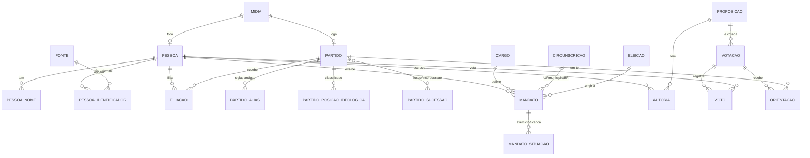

# Plano de Refatoração do Banco de Dados — LegisData

Data da análise: 2026-10-15. Escopo: nova modelagem PostgreSQL, ETL que baixa, lê e popula o banco, e migração de tudo que hoje está "solto" no código.

Este documento é um plano, não uma implementação. Nenhuma tabela ou código foi alterado.

---

## 0. Decisões registradas (2026-10-15)

| # | Decisão |
|---|---------|
| D1 | Cadastrar no banco os **cargos estaduais** (governador, vice, secretário, deputado estadual, deputado distrital) junto com os federais. **Não** popular eleitos estaduais/municipais. Municipais (prefeito, vereador) ficam para depois. |
| D2 | Chaves `bigint identity` + `uid uuid` público. |
| D3 | **Não armazenar CPF.** Nenhuma tabela nova tem coluna de CPF; o tipo de identificador não aceita `CPF`. |
| D4 | Desenvolvimento e testes exigem Postgres (container). |
| D5 | Imagens como arquivo em volume do servidor. |
| D6 | Nomes de tabelas e colunas em português, `snake_case`. |
| D7 | **Opção (a):** remover os indicadores digitados à mão de `seed_executivo.py`. Cada indicador só volta ao banco com fonte oficial verificável e rastreada em `etl.fonte`; a pesquisa de aprovação popular só volta se houver fonte segura. Mapear essas fontes é pré-requisito da Entrega 3. |
| D8 | Janela histórica: **toda a janela (séries econômicas, mandatos, votos e cálculos) começa em 1995-01-01**, primeiro ano completo após o Plano Real (julho de 1994). Decidido em 2026-10-15 para simplificar dados e cálculos. **Confirmado em 2026-10-15:** a linha presidencial exibida começa em Fernando Henrique Cardoso, em 1995-01-01, sem Itamar Franco (aplicar na Entrega 3, junto com o corte das séries econômicas). |
| Processo | Uma branch por entrega; garantir que tudo funciona; **pedir validação local da UI antes de abrir PR**. |

---

## 0.1 Status das entregas

| Entrega | Escopo | Estado |
|---------|--------|--------|
| 1 | Alembic, Postgres nos testes, schemas `ref/core/etl/param`, ponte legado→core, `/parties` | PR #36 |
| 2 | Schema `leg` (proposição, autoria, votação unificada, voto, orientação, presença particionada), ponte legado→leg, pesos do IPPM em `param`, IPPM e linha do tempo da bancada lendo `core`/`leg` | Em validação (branch `refactor/db-entrega-2-legislativo`, empilhada sobre a Entrega 1) |
| 2b | Cobertura: status real, todas as proposições desde 1995, autores sem pessoa, IPPM por período e cadeiras de todos os períodos (Câmara) | Em validação (branch `refactor/db-entrega-2b-cobertura`) |
| 2c | Endpoints de `legislative.py` (proposições, votos, deliberações, calendário, explorer, ranking de autores, rede de coautoria, produtividade), proposições e votos do dossiê em `politicians.py`, Basômetro e `legislative_scoring.py` passam a ler `leg`/`core`; identificadores públicos são os `uid`. A rede de coautoria ignora proposições com mais de 40 autores (assinaturas em massa) e `sync_proposition_authors` deixou de existir (a autoria vem da ponte e do ETL em lote) | Entregue (PR #39) |
| 3a | Economia e Executivo (Fase 6): schema `eco`, mandatos presidenciais em `core`, corte em 1995, remoção de `seed_executivo.py` e de toda leitura de arquivo pela API | Entregue |
| 3b | Dados curados do Executivo e do Congresso (IPLE, composição, salário parlamentar, PNAD) e cron das séries | Entregue |
| 3c | Finanças e fiscalização (Fase 5): schema `fin` com CEAP, emendas, remuneração, patrimônio, doações de campanha e certidões do TSE; dossiê e rotas de emendas lendo `fin` | Entregue |
| 3d | Processos judiciais (DataJud): `fin.processo_judicial`, extrator, carga e dossiê, sem acervo | Entregue (PR #47) |
| 4a | Corte da API (Fase 8): nenhuma rota nem serviço importa mais os modelos legados; repasses, eleições e indicadores sociais em `eco`; busca e dossiê do político em `core` | Em validação (branch `refactor/db-entrega-4a-corte-da-api`) |
| 4b | Entrega final: aposenta o legado sem leitor (17 tabelas do `public`), leva as tabelas de entrada do ETL para o schema `stg` com funções `etl.merge_*`, tira o CPF, cria o papel de leitura da API, o ensaio de restauração e o `ANALYZE` pós-carga | Em validação (branch `refactor/db-entrega-4b-etl-direto`) |

### Entrega 3a — economia e Executivo no banco (2026-10-16)

**O que foi construído**
- Schema `eco`: `eco.serie` (catálogo com fonte de `etl.fonte`, unidade, periodicidade e abrangência) e `eco.observacao` (um valor por série, período e UF; valor desconhecido não é gravado e `referencia >= 1995-01-01` é restrição da tabela). 28 séries, todas de BCB/SGS, IBGE/SIDRA, INPE/PRODES ou IPEA/Atlas da Violência. Visão `eco.vw_resumo_anual` com as colunas que a API já devolvia.
- Mandatos presidenciais em `core`: `core.mandato_presidencial` (identificador público `slug`, rótulo "Lula 2", vice, como o mandato começou e situação), `core.marco_governo` e `core.mandato.papel` (papel de quem foi nomeado). Foto da pessoa em `core.midia`. O nome da pessoa deixou de carregar o rótulo do mandato.
- Carga: `etl/pipelines/economia_loader.py` (séries) e `presidencia_loader.py` (catálogo curado de presidentes), pela etapa `--load-economia` de `run_etl.py`. O `--economic` passou a gravar também `bcb_series_mensais.csv` (câmbio, dívida, salário mínimo, Selic e desocupação mensais).
- Serviços novos: `economia_service` (resumo anual e IPCA mensal), `mandato_economia_service` (indicadores de cada mandato, com os mesmos resultados do JSON antigo, conferidos mandato a mandato), `presidencia_service`, `executivo_service`, `eco_dados`. `economic.py` e `executivo.py` viraram rotas finas; `analytics.py` (`mandates-performance`, `compare-mandates`, `federal-transfers`, `social-classes`) e `politicians.py` (`/presidents`) leem do banco.
- Corte em 1995 (D8): Itamar Franco sai de `core`, do legado, do catálogo, da composição do Congresso, do IPLE e do frontend; as séries econômicas, o IPCA mensal e o resumo anual começam em 1995.
- `seed_executivo.py`, os modelos `PresidentialMandate` e `MandateIndicator` e as tabelas `public.presidential_mandates` e `public.mandate_indicators` foram removidos (migration 0027).

**Reconciliação com o legado**: `GET /economic/annual-summary` e a matriz de `mandates-performance` saem idênticos aos arquivos antigos em todos os anos e mandatos (tolerância de 0,2%). A única diferença é 2026 (e o mandato Lula 3), porque o IPCA mensal avançou um mês desde que o arquivo antigo foi gerado.

**Decisões aplicadas (D7)**: saíram por falta de fonte oficial rastreável a aprovação popular e as emendas mensais do painel do Executivo, o Ibovespa (Yahoo/tabela digitada) e o feminicídio. O painel mostra inflação (IPCA em 12 meses), desemprego (PNAD Contínua, desde 2012), câmbio e Selic meta.

**Deploy da 3a (ordem obrigatória)**
1. `pg_dump` do banco: as migrations 0026 e 0027 apagam dados (Itamar Franco e seus ministros, as tabelas do painel antigo) e o `downgrade` só recria a estrutura.
2. `make db-migrate` **antes** de subir a imagem nova. Enquanto o contêiner antigo ainda atende, `/executivo/*` dá erro, porque `public.presidential_mandates` deixa de existir.
3. Se o banco é novo ou foi migrado antes do `--load-db`, rode `--load-db` e só depois `make run-load-economia`: a migration 0026 só cria o identificador (`slug`) de mandato que já existe, e a carga das séries falha, sem gravar nada, se o catálogo trouxer mandato sem identificador.
4. `make run-etl` agora extrai e carrega (`--economic --load-economia`). `make daily` ainda não atualiza as séries econômicas (3b).
5. Rotas que liam arquivo (`/analytics/social-indicators`, `/analytics/federal-transfers`) devolvem lista vazia quando a tabela não foi carregada, em vez de cair no arquivo.
6. Teste a 0026 numa cópia do banco de produção antes: o `DELETE` em `public.politicos` supõe que só `public.mandatos` aponta para o político.

**Fica para a Entrega 3b**: `wage-disparity` (`salario_vs_inflacao.json`, com o salário parlamentar digitado), `congress-composition` e a composição do IPLE (`composicao_congresso.json` e `DADOS_HISTORICOS_EXECUTIVO`, ambos curados à mão), faixas da PNAD (`pnad_faixas_salario_minimo.json`), repasses e eleições presidenciais por UF direto das tabelas `eco` e a atualização diária das séries no cron. Só então `load_json_cached` ficou sem uso nesses módulos; CEAP e emendas foram para a Fase 5 e saíram na Entrega 3c (o `grep` já não encontra nada).

### Entrega 3b — dados curados do Executivo e do Congresso no banco (2026-10-16)

**O que foi construído**
- `leg.composicao_mandato`, `leg.bancada_mandato`, `leg.presidencia_casa` e `leg.presidencia_casa_mandato`: bancadas por mandato presidencial e Casa (curadoria e eleitos do TSE lado a lado), presidentes das Casas e o resultado da conferência com o TSE. A governabilidade (base, centro, oposição, maioria simples e de PEC) agora é **calculada** das bancadas; antes era digitada. Em dois mandatos a conta difere do número digitado (Lula 1 na Câmara: base 266, e não 218; Bolsonaro: oposição 137, e não 145) porque o número digitado não batia com a lista de partidos do próprio arquivo.
- `leg.producao_executivo`: proposições do Executivo e vetos de cada mandato, insumo do IPLE (saiu da constante `DADOS_HISTORICOS_EXECUTIVO`). A escala ideológica deixou de ser constante: vem de `core.partido_posicao_ideologica`.
- IPLE sem dado inventado: bancadas ou oposição não levantadas deixam X1, X2 e X3 `null` e a calibragem "Indisponível" (antes entravam 1,0 de NEP e 0 de polarização). O período do mandato passa a ser inclusivo (1995 - 1998) em todas as telas.
- Série `SUBSIDIO_PARLAMENTAR` em `eco` (decretos legislativos citados em cada valor; o de 2026, sem norma, saiu) e `disparidade salarial` calculada do salário mínimo, do subsídio e do IPCA, com base 100 em 1995. O placar da MPV 1172/2023 vem dos votos nominais.
- PNAD: `eco.pnad_faixa`, `eco.classe_social`, `eco.pnad_ano`, `eco.pnad_distribuicao` e `eco.pnad_metodologia`. Sem os microdados do ano, `GET /analytics/social-classes` responde 404; a estimativa fixa digitada saiu.
- Cargas `composicao_loader` e `pnad_loader` na etapa `--load-economia`, e a atualização diária das séries (`economia_atualizacao`) como etapa 1c do cron.
- Saíram: `salario_inflacao_extractor` e a etapa `--renda`, o fallback em arquivo do explorador de proposições e `load_csv_cached`. Nenhuma rota de economia, Executivo ou composição abre arquivo de `etl/data`; a CEAP e as emendas saíram na 3c.

### Entrega 3c — finanças e fiscalização no banco (2026-10-16)

**O que foi construído**
- Schema `fin` (migration 0031): `fin.despesa_cota` (CEAP por pessoa, ano e tipo de despesa), `fin.despesa_cota_fornecedor` e `fin.despesa_cota_resumo` (maiores fornecedores e quantidade de notas), `fin.emenda`, `fin.remuneracao`, `fin.declaracao_patrimonio`, `fin.doacao_campanha` e `fin.certidao`. Cada linha aponta para `etl.fonte` (D7). CPF de fornecedor nunca é gravado (só CNPJ de 14 dígitos); o CPF do doador chega mascarado do TSE e um CPF completo seria mascarado na carga (D3).
- Grão da CEAP: o ETL publica o total por parlamentar, ano e tipo, mais os 15 maiores fornecedores, não nota por nota. O banco guarda exatamente isso; a tabela "Últimos comprovantes fiscais" do dossiê, que mostrava esses totais anuais como se fossem notas, virou "Gasto da cota por ano". Nota por nota (cerca de 4 milhões de linhas desde 2009) fica para quando houver necessidade de mostrar o documento.
- Emendas: uma linha por emenda, localidade e função, com o tipo de autor (`INDIVIDUAL`, `BANCADA_ESTADUAL`, `COMISSAO_INSTITUCIONAL`, `RELATOR_GERAL`) e a UF de destino já classificados pela carga. Emenda de comissão de 2019 "sem informação" de código entra sem código (R$ 190 milhões empenhados que antes se perderiam no total). As rotas `/emendas/resumo`, `/emendas/localidade/{x}` e `/emendas/autor/{x}` e o dossiê leem do banco; a UF do ranking vem da carga em vez de uma busca por trecho de nome.
- Autor de emenda sem pessoa (decisões 1 e 2 de `DECISOES_E_DUVIDAS_PENDENTES.md`, opção 1 nas duas): `pessoa_id` fica nulo e o nome oficial da fonte fica em `autor_texto`, com `autor_situacao` = `NAO_CADASTRADO` (mandato anterior ou fora da base), `HOMONIMO_NAO_DESAMBIGUADO` ou `INSTITUCIONAL`. Homônimo só é desfeito quando exatamente uma das pessoas tinha mandato no ano da emenda.
- Resolução de pessoas (`etl/pipelines/pessoa_resolver.py`): identificador oficial da Câmara/Senado e depois nome único. Enquanto as pessoas duplicadas não são unificadas, o cadastro do legado (sem identificador, mas com `camaraId`/`senadoId` em `public.politicos`) e o cadastro novo (com identificador) contam como uma pessoa, e o dado é gravado no cadastro com identificador; o dossiê (endereçado pelo `uid` do legado) o alcança pelo `camara_id`/`senado_id`. O nome é comparado com o título ("Padre João" não é "Dr. João"), e homônimos são desfeitos pelo mandato no ano da emenda (quem só teve mandato em outros anos é descartado; quem não tem mandato cadastrado é desconhecido, não descartado). Com isso as emendas sem vínculo por homonímia caíram de 12.796 para 878 (30 nomes, quase todos senadores cujo mandato de 2019 a 2022 não está em `core.mandato` e que também existem como ex-deputados, sem ligação entre os dois cadastros).
- Dossiê e rotas `/ceap`, `/emendas`, `/certidoes` e `/doacoes` leem de `fin` por `financas_service`; `emendas_service` serve as rotas de `/emendas`. `app.core.data_files.load_json_cached`, `PROCESSED_DATA_DIR` e a montagem `./etl/data` do contêiner da API saíram: **nenhuma rota abre arquivo do ETL**. Contrato público que mudou: `GET /politicians/{id}/ceap` devolve só totais por ano e tipo (`ano`, `tipo`, `valor`) e `total_gasto` e `total_notas` passaram a ser nulos quando a fonte não informa o dado (`possui_dados` indica se há despesa); a quantidade de notas de um fornecedor (`num_notas`) também pode ser nula; a lista nota a nota (`ano`, `mes`, `fornecedor`, `data`, `url`) saiu e a decisão sobre trazê-la de volta está em `docs/DECISOES_E_DUVIDAS_PENDENTES.md`. `GET /emendas/autor` e `/emendas/localidade` passaram a exigir ao menos 3 caracteres (400 abaixo disso; a busca por localidade aceita ainda a sigla do estado, com 2). A aba "Bancadas & Relator" ganhou um campo de busca livre por autor, com o mesmo mínimo e o mesmo máximo da busca por localidade. O índice "Evolução patrimonial vs. remuneração" compara só declarações do mesmo período do subsídio registrado, cortado nas duas pontas: a base é a última declarada até o primeiro ano da remuneração, o fim é a última declarada até o último ano dela, e o divisor soma só o subsídio dos anos depois da base até o fim da janela (o ano da base fica de fora, porque a declaração dele já traz o patrimônio acumulado até ali). A rota devolve `periodo_comparado` com `de`/`ate` (declarações) e `subsidio_de`/`subsidio_ate` (a aba de inteligência mostra os dois períodos). A comparação fica indisponível quando não há base, não há declaração posterior dentro da janela, a base é mais de um ano anterior ao primeiro ano de subsídio registrado (a fonte de remuneração começa em 2019: o patrimônio dos anos sem subsídio inflaria a razão), falta o subsídio de algum ano da janela ou não há subsídio nela. `custos_ceap.gasto_total_recente` é nulo (não 0) para quem não tem CEAP, e com ele `concentracao_ceap.indice_hhi`, `concentracao_ceap.percentual_maior_fornecedor` e `roi_cidadao.custo_total_operacional`. Na busca por localidade, a sigla de estado ("AL", "SP") vale pela coluna `uf` (o estado e os seus municípios), nunca como trecho do nome; o nome do estado por extenso ("São Paulo", "Tocantins") é busca por trecho do nome, que acha a capital e o "estado (UF)" sem trazer os demais municípios e mantém alcançáveis os municípios homônimos de estado; a busca por autor devolve `quantidade_autores` e `autores_encontrados` (com mais de um autor, os totais somam todos). O resumo de financiamento de campanha (dossiê e `/doacoes`) considera uma eleição só (a mais recente, ou a pedida em `/doacoes?ano_eleicao=`; 404 se ela não tem doações mas há doações de outras eleições, e 200 vazio, com `ano_eleicao` nulo, para quem não tem nenhuma), conta doadores distintos (`total_doadores`), soma os recibos de cada um, não funde doadores sem nome e sem documento e lista as `eleicoes_disponiveis`. A fonte publica só os 20 maiores doadores de cada candidato e uma linha agregada "Demais doadores (N)" que preserva o total: ela é gravada com `agregado` e `quantidade_doadores` = N, nunca entra no top 5, soma N em `total_doadores` (nulo se a fonte não informa N) e vai em `demais_doadores`; `/doacoes` também devolve `possui_dados` e `ano_eleicao`. `fin.despesa_cota_fornecedor` identifica o fornecedor pela coluna gerada `grupo` (CNPJ ou, sem ele, o nome), única por pessoa; a rota de emendas por autor devolve sempre `quantidade_autores` e `autores_encontrados` (cada autor uma vez; com mais de um, os totais somam todos).
- Carga `etl/pipelines/financas_loader.py` na etapa `--load-economia` (chave `financas` de `carga_economica`): seis cargas independentes, cada uma numa transação; arquivo ausente ou sem registro utilizável nunca apaga o que está no banco; emenda é atualizada pela chave natural (o `uid` público não muda) e o que saiu da fonte sai da tabela.
- Reconciliação: `python -m etl.scripts.reconciliar_financas` compara, por ano, o total do arquivo com o do banco. No banco de desenvolvimento: emendas (54.362 linhas, R$ 274,5 bilhões empenhados) e remuneração (39.263 meses) batem ao centavo; a CEAP fica 0,4% abaixo do arquivo (23 entradas que não são pessoa, como "LIDERANÇA DO PT", e um senador sem cadastro); as doações de 2022 ficam R$ 126 milhões abaixo porque as prestações de Jair Bolsonaro e Michel Temer não têm vínculo (cada um existe em dois cadastros sem ligação entre si).

**Regras de segurança da carga e da busca (revisão da branch)**
- A carga nunca apaga por arquivo ruim: ausente, vazio, sem proveniência, de tipo errado ou sem linha utilizável (por exemplo prestações de doação sem doadores) deixa o banco intacto. Além disso, uma carga que reduziria uma tabela com 10 linhas ou mais a menos de 50% do que ela já tem aborta com erro e sem alterar nada (arquivo truncado ou resolvedor degradado); uma redução legítima é liberada com `LEGISDATA_ACEITAR_ENCOLHIMENTO=1`.
- Valor desconhecido não vira zero: emenda sem valor pago fica de fora (e é contada em `invalidas`; o extrator atual grava `valor_pago` 0 quando a fonte não traz o campo, então esse filtro só vale para arquivo gerado por outro caminho), CEAP sem total de notas não grava linha em `despesa_cota_resumo` (a API devolve `total_notas` nulo e a tela não mostra o contador) e o dossiê sem remuneração devolve `total_bruto_2023` nulo.
- Chaves repetidas no arquivo: emendas com a mesma chave natural somam os valores (o total bate com o arquivo; a contagem fica em `chave_repetida`); na CEAP, entradas da Câmara e do Senado para a mesma pessoa somam e variantes do nome na mesma fonte não dobram (fica a de maior valor e a colisão é contada em `mesma_fonte_repetida` e registrada em log; limitação: se as duas variantes cobrirem períodos diferentes, fornecedores e resumo ficam só com a de maior valor, e a reconciliação com o arquivo real não mostra nenhuma colisão hoje); na doação, a prestação mais completa de uma pessoa e ano vale.
- CPF: `nome_do_fornecedor` e o nome do doador perdem qualquer sequência de 10 ou 11 dígitos, juntos ou separados por ponto, hífen, barra, vírgula, sublinhado ou espaço (o CNPJ formatado é preservado); `documento_do_doador` só devolve CNPJ no formato canônico (14 dígitos ou `NN.NNN.NNN/NNNN-NN`) ou a máscara exata `***.NNN.NNN-**` (CPF completo ou de 10 dígitos é mascarado, qualquer outro formato vira nulo, nunca texto cru) e o CHECK da tabela exige o mesmo formato. Valores monetários de 10^12 em diante, `NaN` e `Infinity` são tratados como inválidos para não estourar as colunas `numeric`.
- Busca pública de emendas: o termo precisa de 3 a 100 caracteres (`400` abaixo e `422` acima; a sigla de estado, com 2, vale só na busca por localidade) e o tamanho que conta é o do termo normalizado pelo banco (três acentos combinantes têm 3 caracteres brutos e 0 normalizados, e virariam um `LIKE '%%'`), e a comparação sem acento nem caixa fica na função SQL `ref.contem_texto` (um `LIKE` com o trecho escapado, para o planejador usar os índices trigram `ix_emenda_autor_trgm` e `ix_emenda_localidade_trgm` e o termo de 2 letras, que não usaria o índice, só entra como sigla de estado, que filtra pela coluna `uf`). Cada busca é uma consulta só: as emendas que casam entram num CTE materializado e totais, autores, destinos, áreas e a lista leem dele no mesmo comando, sem tabela temporária por requisição nem ids indo ao Python. A busca roda com `statement_timeout` de 8 s (`TEMPO_MAXIMO_DA_BUSCA_MS`, valendo só na transação) e no máximo 3 buscas por vez por processo (`EMENDAS_MAX_BUSCAS_SIMULTANEAS`, sempre abaixo de `DB_POOL_SIZE + DB_MAX_OVERFLOW`; além disso a API responde 503 em vez de esgotar o pool); se o banco cancela a consulta, a API responde 400 "A busca é ampla demais; informe um termo mais específico." O painel do frontend mostra o texto do 400 e do 503 e não oferece repetir a busca no 400. Os `id` de `fin.doacao_campanha` e da CEAP são efêmeros (as tabelas são recriadas a cada carga); só o `uid` da emenda é estável entre cargas.
- A CEAP e as emendas do `fin` são atualizadas todo dia pela atualização diária (ver abaixo). Para as demais cargas do `fin` (remuneração, patrimônio, doações, certidões), depois de qualquer extração manual (`--camara`, `--tse`) é preciso rodar `run_etl --load-economia` para o banco refletir o arquivo (com CEAP e emendas já no `fin` essa carga só recarrega as estáticas; para levar CEAP e emendas de arquivos gerados à mão use `--load-economia --recarregar-ceap-emendas`). Os loaders legados (`--load-db`, `--load-presenca`) continuam gravando em `public.*`, que a API já não lê; ficam até a Fase 9.

**Resolução por nome com ano:** nome com candidato único vale mesmo que os mandatos cadastrados da pessoa sejam de outros anos. Foi medido: exigir mandato no ano desligaria 1.074 emendas (de 50.100 identificadas para 49.026), todas de parlamentares reais (Otto Alencar, Cid Gomes, Chico D'Angelo, Flávio Bolsonaro...) cujo mandato de Senado anterior a 2023 não está em `core.mandato`. O risco oposto (um autor atual que ainda não está no cadastro com o mesmo nome de um ex-parlamentar) fica aceito e deve cair com o cadastro completo de mandatos do Senado. O `ano` da emenda é o do Portal da Transparência (ano da LOA), usado como proxy do ano da autoria; homônimos com mandatos consecutivos podem ser atribuídos ao sucessor quando a autoria foi no ano anterior (risco aceito e raro).

**Contrato de "desconhecido não é zero" no dossiê (13ª revisão):** sem emenda na base, `emendas_parlamentares.total_empenhado`, `total_pago` e `percentual_execucao`, `/politicians/{id}/emendas` (`total_empenhado`, `total_pago`) e `indices_inteligencia.eficiencia_emendas` (totais, `percentual_pix`, `concentracao_municipio_predileto_pct`, `taxa_conversao_pct`) vêm `null`, não 0.0; sem doação registrada `financiamento_campanha.total_arrecadado` e `total_doadores` vêm `null`; sem folha `financas_service.remuneracao()["acumulado"]` é `None`. As taxas de execução (`percentual_execucao`, `taxa_conversao_pct`, `taxa_execucao_pct` e `taxa_execucao_pago_pct` das buscas) são `null` quando o empenhado é zero (pago sem empenhado não é 0% de execução; a função é `numeros.taxa_ou_desconhecida`, e `pct` segue para a participação de uma parte no total que a contém). O frontend mostra "Indisponível" (`fmtReais`, `fmtPct`) em todos esses campos.

**Comparação patrimônio × subsídio (13ª revisão):** a janela é montada em `financas_service.comparacao_patrimonial` (a rota só chama). `subsidio_na_janela` devolve `(soma, meses com folha)` ou `None` quando falta algum ano da faixa ou quando um ano do MEIO da faixa (nem o primeiro nem o último, que podem ser parciais por posse ou fim de mandato) tem menos de 12 meses; os meses entram em `periodo_comparado.meses_de_subsidio` e a tela mostra "(N meses de folha)". Subsídio zero na janela não dá razão e conta como comparação impossível. A mesma eleição vinda de duas pessoas ligadas ao parlamentar vira uma declaração só (a de maior valor), para a base e o fim da janela não dependerem da ordem do banco. Um doador sem documento é identificado pelo nome: dois homônimos sem documento contam como um doador (a quantidade pode sair menor); a alternativa, um doador por recibo, contaria o mesmo doador várias vezes.

**Concentração de fornecedores e ROI (13ª revisão):** o rótulo "Fornecedor não identificado" (lançamentos sem nome, de fornecedores diferentes) fica fora do HHI e do maior fornecedor, mas dentro do gasto total (`financas_service.FORNECEDOR_NAO_IDENTIFICADO`, igual ao rótulo do ETL, com teste de paridade). Se os maiores fornecedores somam mais que o gasto total (as duas fontes não cobrem o mesmo período) o índice fica `null` com diagnóstico próprio, em vez de passar de 100%. A metodologia do ROI diz que os pontos IALP são da carreira registrada enquanto o custo cobre só os anos das fontes (CEAP e folha, de 2019 em diante), então quem teve mandatos anteriores fica com o custo por ponto subestimado, e que sem folha (como os senadores) a nota fica indisponível. `UF_POR_NOME` (ETL) e `_ESTADOS_MAP` (API) têm teste de paridade.

**Cargas de finanças (13ª revisão):** `financas_loader.carregar` passa todo erro por `loader_helpers.descricao_do_erro` (a mesma função do `carregar_tudo`), então o `DETAIL` do Postgres não chega ao log nem ao erro final; a guarda de resolvedor degradado também vale para `fin.emenda` (se as emendas com autor identificado cairiam a menos da metade, a carga aborta, porque o upsert regrava `pessoa_id`). Na CEAP, um total de ano e tipo que não cabe em `numeric(14,2)` (ou uma soma Câmara + Senado que não cabe) tira a pessoa inteira da carga (`total_fora_da_faixa` e `pessoas_sem_gasto_completo`), pois um gasto parcial não vale como total. `EMENDAS_MAX_BUSCAS_SIMULTANEAS` é validada na inicialização (de 1 até `DB_POOL_SIZE + DB_MAX_OVERFLOW - 1`) e o `docker-compose.yml` repassa essa variável e as do pool. O resumo do dossiê mostra a eleição mais recente e avisa quando há doações de outras eleições; um seletor de eleição fica para depois (a API já aceita `?ano_eleicao=`). As cargas legadas de `tse_loaders` seguem gravando em `public.*` sem leitor até a Fase 9.

**Atualização diária de CEAP e emendas (pós-3c):** `etl.pipelines.financas_atualizacao` extrai e recarrega só as fontes gravadas do `fin` (CEAP e emendas), com a CEAP de cada ano já fechado (depois de 1º de abril do ano seguinte) em cache por ano (`etl/data/raw/ceap_por_ano`, fora do git, sem CPF; `CeapAccumulator.para_json/de_json/mesclar`, formato travado por teste e versionado), então só o ano corrente vai à rede. Roda por `legisdata-financas.timer` (usuário, 05:37 UTC) e também como etapa 1d de `cron_daily_consolidation` (lock no pipeline e, onde o processo enxerga o `deploy.lock`, pula a execução com deploy em andamento). O deploy semeia o `fin` dos arquivos do git quando ele está vazio e, com o `fin` já carregado, só semeia a CEAP ou as emendas que o timer ainda não assumiu; uma fonte assumida nunca volta ao retrato do git (`carregar_tudo` ganhou `plano_do_modo`, o mapa `FINANCAS_POR_MODO`, que diz quais fontes de `financas_loader` cada modo roda, e o argumento `opcoes`, um dicionário de argumentos nomeados por carga: `opcoes["financas"]` leva `chaves` e o gancho `ao_confirmar`; com `chaves` explícitas que incluem "financas" faltar `opcoes["financas"]["chaves"]` levanta `ValueError`, como opções de carga que não existe ou não roda; a política de semeadura fica em `etl/pipelines/semeadura_das_financas.py`). Um ano fechado cuja nova baixa falha usa o cache vencido como reserva (`ceap_anos_cache_vencido` no resumo), e o vazio do ano novo só vale até março e só se o arquivo anterior ainda não tinha gasto daquele ano. O deploy só considera uma fonte "do timer" (e portanto fora do alcance da semeadura do git) depois que a atualização diária a CARREGA no `fin` com sucesso, o que ela registra em `etl.execucao` (`parametros.fresca = true`) na mesma transação da carga (a semeadura do git grava a linha contrária e revoga a posse); os modos do deploy são `completa`, `sem_emendas`, `sem_ceap`, `estaticas` e `nenhuma` (`FINANCAS_POR_MODO`). Em desenvolvimento, `make daily` (etapa 1d) regrava `etl/data/processed/*.json`, que são versionados: confira o `git status` antes de commitar. O servidor não tinha nenhum agendador diário até aqui (só o do deploy); detalhes, instalação e a interação com o deploy em `docs/DEPLOY_AUTOMATICO.md`. Na extração, o fornecedor perde o CPF do documento e o CPF embutido no nome, e também o número de 12 dígitos (e as variantes agrupadas de 11 ou 12 dígitos) colado ao nome de pessoa física (visto nos dados reais; não dá para saber se é um CPF com enchimento, então sai por precaução); o CNPJ de 14 dígitos de empresa e de MEI fica, e um CPF válido com zeros à esquerda (`000` + 11 dígitos) não passa por CNPJ, nem com nome de empresa ao lado: só um número inteiro medido e posto em `CNPJS_ZERADOS_CONHECIDOS` escapa (uma allowlist por raiz liberaria quase todos os CPFs de raiz `00000000` e `00000531`, cujos pesos do DV de CNPJ coincidem com os de CPF); a mesma regra vale no loader, no extrator do TSE e na guarda de D3, e a extração conta (sem expor o número) os documentos descartados por ela (`ceap_cnpjs_ambiguos_descartados`). Um CPF colado a 2 ou mais dígitos (13 ou mais corridos), repartido por separadores de qualquer tipo (constantes ou mistos, em cadeia de exatamente 11 dígitos) ou que perdeu o zero inicial no desenho `NN.NNN.NNN-NN` também sai do nome e do texto livre. Decisões conscientes do lado seguro de D3: um telefone de 11 dígitos escrito com espaços que feche o dígito verificador de CPF (cerca de 1%) também sai do texto livre, e no texto livre `R$` antes do número, ou dígitos corridos seguidos de `,NN`, são tratados como valor em reais e ficam (a guarda de arquivos versionados acusa esses casos, o banco `fin` não tem guarda). O arquivo `despesas_ceap_2019_2026.json` versionado foi saneado nesta entrega (451 documentos de 11 dígitos e os números de 12 dígitos dos nomes saíram; nomes que passaram a coincidir foram somados, e a visão do loader, `fornecedores_do_parlamentar`, ficou idêntica para todos os parlamentares), mas o HISTÓRICO do git continua com os documentos originais (decisão pendente: reescrever o histórico exige force-push).

**Pontos para a Fase 9 e para a unificação de pessoas:** o resolvedor (`pessoa_resolver`) e `financas_service.pessoas_do_parlamentar` ainda usam `public.politicos` (`camaraId`/`senadoId` e o `uid`) para juntar o cadastro do legado ao que tem identificador; ao remover o legado, a unificação de pessoas precisa estar feita (e `fin.emenda.pessoa_id` é `ON DELETE RESTRICT`: religue as emendas à pessoa canônica antes de apagar a duplicada). Enquanto o legado existe, `--load-db` e `--load-presenca` ainda gravam CEAP, emendas e remuneração em `public.*`, que a API já não lê; a fonte do dossiê é só `fin`, carregado por `--load-economia`. `fin.remuneracao.cota_ceap`, `auxilio_moradia` e `outros_beneficios` ficam nulas até haver fonte oficial mensal. `UF_POR_NOME` (ETL) e `_ESTADOS_MAP` (API) são cópias independentes do mesmo mapa; o campo `uf` das emendas já vem classificado pela carga.

**Ao aplicar esta branch num banco que já rodou a 0031 antiga:** a 0031 foi editada antes de qualquer deploy (ela não está em `main`), então bancos de desenvolvimento precisam ser recriados com `alembic downgrade 0030 && alembic upgrade head` e a carga rodada de novo (`run_etl --load-economia`).

**Fica para a 3d**
- Processos judiciais: entregues na 3d (estrutura, sem acervo; ver abaixo).
- Novo ETL (Fase 7) e remoção das tabelas legadas (Fase 9, depois de duas semanas de observação).
- Unificação de pessoas duplicadas: é ela que vincula as emendas dos 68 nomes ambíguos e as doações de Bolsonaro e Temer.

**Deploy:** o script de deploy já roda `carregar_tudo`; a migration 0031 e a carga de finanças entram sozinhas. A API perde a montagem de `./etl/data`, então o `docker compose up` recria o contêiner do backend. **Rollback:** se a verificação de saúde falhar, o script volta a imagem anterior com o `docker-compose.yml` novo (sem o volume `/etl_data`); a imagem da 3b lê CEAP e emendas de arquivo e, sem o volume, essas rotas respondem vazias sem erro. Se isso acontecer, restaure o volume no compose do commit anterior ou corrija para frente.

### Entrega 3d — processos judiciais (DataJud)

**Decisão sobre a fonte (D7):** o DataJud (CNJ) só consulta por número de processo e não expõe as partes, então ele nunca descobre os processos de uma pessoa. O acervo que existia (`REGISTROS_PROCESSUAIS_NOTORIOS`, números, ementas e desfechos de pessoas reais transcritos à mão e nunca conferidos nos tribunais) foi removido junto com `processos_loader.py` e a opção `--allow-unverified-legal`. As certidões do TSE do `fin` não servem de ponte: são 4 registros de candidatura (2006 e 2010) cujo número de processo (`6527`, 17 dígitos) não tem o formato CNJ. Resultado: **a tabela nasce vazia** e só recebe um processo quando ele vier de uma fonte oficial que ligue processo e pessoa.

**Como entra um processo:** `etl/data/processed/processos_curados.json` é uma lista de entradas (`nome_civil`/`nome_eleitoral`/`camara_id`/`senado_id`, `numero_processo` no formato CNJ e `link_comprovacao`, o link `https` da fonte oficial que liga o processo à pessoa: domínio `.jus.br`, `.gov.br`, `.leg.br` ou `.mp.br`, sem espaço, sem barra invertida, sem credencial e sem CPF, inclusive codificado em quantas camadas forem (a decodificação vai até o ponto fixo; link que ainda muda depois de 6 voltas é recusado), porque a consulta de um tribunal por documento da parte leva o CPF na URL e um link mascarado não comprovaria nada). `python -m etl.run_etl --processos` (`etl/extractors/processos_extractor.py`) valida o número (formato exato ASCII e dígitos verificadores, módulo 97 da Resolução CNJ nº 65/2008), consulta o DataJud e grava `processos_judiciais.json`; só extrai, e `--load-economia` carrega o arquivo na carga `processos` do `fin` (uma das estáticas). O host do link precisa ser nome DNS puro (letras, dígitos e hífen): a barra invertida em `https://x.example\.jus.br/` faz o navegador ir a `x.example` enquanto o Python lê um domínio `.jus.br`, e `[`, `@` e `;` são recusados pelo mesmo motivo; link malformado nunca derruba o lote (conta `invalidas`). A pessoa é resolvida só pelo identificador oficial (`camara_id`/`senado_id`, `ResolvedorDePessoas.por_identificador`): a regra de nome único das emendas, num processo judicial, poderia atribuir uma ação a um homônimo, então a entrada sem identificador conhecido fica de fora (`sem_identificador` no extrator, `sem_pessoa` na carga); texto livre passa pelo saneamento de CPF (D3), preservando o nome oficial (`1ª Vara`, que a normalização do detector viraria `1a`).

**A curadoria é a fonte de verdade.** O arquivo gerado reflete exatamente o que ela contém e o DataJud confirma, e fica de fora (e é contado) o processo com número inválido, link que não é de fonte oficial (`invalidas`), de um tribunal que o DataJud não cobre (`sem_cobertura`: o STF, por exemplo, não tem índice; essa fonte precisa de outro caminho), que o DataJud não tem (`nao_encontrados`), de documento malformado, sem classe oficial (`sem_classe`, a classe nunca é inventada), sob sigilo (`sigilosos`: `nivelSigilo` diferente de zero ou ilegível) ou cujo documento devolvido não é o número pedido (`divergentes`). Um processo que já estava no arquivo gerado e que não se confirma agora (o DataJud deixa de achar, o documento vem malformado, de outro número, sem classe, ou o tribunal perde a cobertura) conta como `publicados_sem_confirmacao`: a extração aborta com `ProcessoPublicadoSemConfirmacao` e nada muda. Retirar um vínculo já publicado só vale por remoção explícita na curadoria (ou por o processo ter passado a correr em sigilo), nunca por um sinal fraco como a resposta vazia de um tribunal que migrou de sistema. O texto livre do DataJud já sai sem CPF no arquivo versionado, não só na carga. Um teste exige que o gerado tenha exatamente os números da curadoria (uma entrada nova sem `--processos` rodado, ou que o DataJud não confirma, quebra o CI). Uma curadoria válida e vazia grava `[]`, e a carga trata `[]` como "limpar a tabela": é o caminho para retirar um vínculo errado do dossiê. Arquivo ausente, de formato inválido, ou com registros dos quais nenhum serve (número inválido, ninguém se resolve, sem proveniência) não apaga nada, e a guarda contra encolhimento vale (esvaziar 10 processos ou mais exige `LEGISDATA_ACEITAR_ENCOLHIMENTO=1`).

**Falha de rede não apaga processo.** `DataJudClient.consultar_processo` devolve `None` só quando todos os tribunais consultados responderam e nenhum tem o processo; 429 esgotado, HTTP diferente de 200, timeout, corpo ilegível ou hit sem documento levantam `ErroDoDataJud`, que o extrator conta como `erros` e que faz `extrair` abortar SEM gravar (o arquivo anterior fica e a etapa falha para o cron registrar). "Não encontrado" fica em cache só por `CACHE_NEGATIVO_DIAS` (7), porque o tribunal pode indexar o processo depois, e o achado só por `CACHE_POSITIVO_DIAS` (1): um último movimento congelado faria o dossiê mostrar o andamento antigo (um julgamento posterior não apareceria). Cache vencido, ou gravado no futuro além de 5 minutos de deriva de relógio, conta como vencido: com o DataJud fora do ar levanta erro, nunca serve o dado velho. O cache grava `fetched_at` com o deslocamento de Brasília, e `consultado_em` é o dia (Brasília) em que o documento foi de fato lido, o da gravação do cache quando veio dele. Se o mesmo número vier em mais de um documento (um por grau), vale o de atualização mais recente. As datas do DataJud (ISO em UTC ou compactas) viram o dia em Brasília; meia-noite UTC é como ele escreve uma data sem hora e vale o dia escrito. O mapa de tribunais tinha 25/26 trocados (Sergipe e São Paulo): os processos do TJSP (`8.26`) eram consultados no TJSE; corrigido, e a Justiça Militar de SP (`9.26`) também.

**`fin.processo_judicial`** (migração 0032): `numero_cnj` (formato CNJ, com `CHECK`), tribunal, grau, classe (obrigatória e não vazia), assuntos (sem elemento nulo), órgão julgador, datas de ajuizamento e do último movimento, `consultado_em` (o dia em que o DataJud foi consultado), `total_movimentacoes` (>= 0), `vinculo_url` (obrigatório, `https://` sem espaços), fonte `DATAJUD`; único por `(pessoa_id, numero_cnj)`. O que o DataJud não devolve fica nulo. A 0032 foi editada antes de qualquer deploy (não está em `main`): bancos de desenvolvimento que já a aplicaram precisam de `alembic downgrade 0031 && alembic upgrade head`.

**Dossiê:** `judicial_service.enriquecer_registros_judiciais` (a consolidação saiu da rota) lê `fin.processo_judicial` e `fin.certidao`, não mais `public.processos_judiciais` (que fica até a Fase 9). A flag legada `politicos.possuiProcessosDeclarados` deixou de contar (veio do acervo manual e, sem processo para mostrar, o selo não teria o que comprovar): `ficha_limpa.possui_processos_declarados` e `perfil.possui_processos_declarados` vêm do que existe no `fin` (processo localizado ou certidão positiva). A certidão positiva do TSE aparece em `processos_detalhados` junto dos processos do DataJud (antes só aparecia na ausência de processo detalhado). Não há desfecho inferido (presunção de inocência): `situacao_juridica` do processo mostra só "Último movimento registrado no DataJud: ... Consultado em AAAA-MM-DD." (ou "Sem movimentação registrada no DataJud."), e a da certidão do TSE é `null`. Os dois tipos de item de `processos_detalhados` têm as mesmas chaves e dado ausente é sempre `null` (o "n/d" é só da tela). O frontend deixou de classificar o texto do último movimento por palavra-chave (antes "improcedente" pintava de verde e "inelegibilidade" de vermelho, o que inferia desfecho): todo cartão tem cor neutra, o link é rotulado como a fonte do vínculo, e `getFichaStatus` devolve "desconhecido" (não "sem processos") quando `dados_certidoes_disponiveis` é falso. O selo, antes "Processos Declarados", agora diz "Processos Vinculados" (`status_geral`) e significa "há processo ou certidão positiva ligado à pessoa por fonte oficial"; a curadoria não guarda o papel da pessoa no processo. O contrato mudou em dois pontos: ausente passa a ser `null` (antes `"n/d"`) e `status_geral` mudou de texto.

**Para a Fase 7 e a 9:** o `DataJudClient` ainda usa `requests` direto (a regra de ETL pede `HttpClient`); migrar quando o conector do DataJud virar um `Conector` do novo ETL. `backend/app/main.py` ainda recria a tabela legada `processos_judiciais` no `CREATE TABLE IF NOT EXISTS` do boot; some junto com ela na Fase 9. Na Fase 9 também: o model `ProcessoJudicial` e a relação em `Politician`, e as linhas do acervo manual que ainda estão em `public.processos_judiciais` e a flag `politicos.possuiProcessosDeclarados` em produção (dados de pessoas reais que a D7 mandou remover; nenhum código lê mais, mas continuam no banco até a migração de limpeza).

### Entrega 4a — corte da API (Fase 8)

**Enums:** os enums de domínio (casa, voto, cargo, status de tramitação...) saíram dos módulos dos modelos legados para `app.models.enums`. Os modelos legados e `app.models` os reexportam.

**Fidelidade partidária:** `GET /analytics/party-fidelity` lê `core.mandato`, `core.filiacao` e `core.partido` (`party_fidelity_service`). O fim de uma filiação é o último dia (o `daterange` de `core` guarda o limite superior exclusivo, então a API subtrai um dia).

**Repasses, eleições e indicadores sociais em `eco`:** a migração 0033 cria `eco.repasse_federal` (transferências da União por mandato presidencial, UF e área; o mandato é a chave estrangeira de `core.mandato_presidencial` e o `slug` público vem de lá; estorno entra negativo) e `eco.resultado_eleitoral_uf` (primeiro e segundo colocados por eleição, turno e UF, com o total de votos válidos). Estado e região vêm de `ref.uf`, sem repetir. `territorial_loader` (carga `territorial` de `carga_economica`, depois de `presidencia`) carrega `repasses_federais_uf.json` (só com proveniência oficial) e `eleicoes_presidenciais_uf_tse.csv` (só linhas `verificado` contra o TSE: a digitação manual nunca entra); substitui o retrato de cada mandato e de cada eleição que o arquivo traz e não apaga a base se o arquivo faltar ou não tiver linha válida. A série `INSEGURANCA_ALIMENTAR_TOTAL_PCT` completa o histórico nacional, e a pesquisa de onde sai cada Gini (`serie_gini`) vai para a `nota` da observação. `GET /analytics/social-indicators`, `social-elections`, `federal-transfers` e `compare-mandates` leem `eco` (`territorial_service`). Os passos legados `_load_federal_transfers`, `_load_social_and_election_data` e `carregar_eleicoes_tse` do ETL antigo, os modelos ORM dessas quatro tabelas e o DDL delas em `app/main.py` saíram; as tabelas do `public` ficam até a Fase 9.

**Busca e dossiê do político em `core`:** `politico_service` resolve o político (UUID, ID da Câmara/Senado ou nome exato) e faz a busca; o dossiê lê a trajetória de `core`. Nada em `app/api` nem em `app/services` importa mais `app.models.politician`, `app.models.legislative` ou `app.models.economic`.

- *Cadastros duplicados unificados.* O cadastro público (o `uid` do dossiê) veio do legado e o histórico da Câmara/Senado criou outro cadastro da mesma pessoa, que ficou com o identificador oficial (`core.pessoa_identificador` é único por tipo e valor): no banco de desenvolvimento, 268 dos 1.066 políticos do legado tinham o ID da Câmara e 70 o do Senado em outro cadastro, e é por esse identificador que o dossiê chega às finanças. A migração 0034 cria `core.unificar_pessoas(manter, apagar)`, que passa para o cadastro público tudo o que aponta para o duplicado (toda chave estrangeira para `core.pessoa`, achada no catálogo, então tabela nova entra sozinha), junta o mesmo mandato dos dois cadastros (mesmo cargo e início, ou a mesma chave natural) levando junto o que depende dele, completa só os campos vazios e apaga o duplicado; a linha que colidiria é descartada e vale a do cadastro público. `core.unificar_duplicadas()` acha os pares pelo legado e roda na própria migração e depois de cada sincronização do legado (`sync_legacy_to_core`), até a Fase 9 tirar o legado. No banco de desenvolvimento, 338 cadastros foram unidos (3.383 para 3.045 pessoas) e nenhum político do legado ficou sem o próprio identificador. O novo ETL (Fase 7) resolve a pessoa pelo identificador na carga e não cria a duplicata; sem isso o `uid` público não sobrevive à unificação.
- *Contrato que mudou (validar na tela).* (1) `GET /politicians` passa a listar todo cadastro com algum mandato, e não só o cadastro público do legado: no banco de desenvolvimento o total sem filtro foi de 1.066 para 2.170 (ex-parlamentares desde 1995 que só existiam em `core`), o que muda a ordem e a paginação da lista sem filtro; com `office` e `uf` o conjunto é o mesmo de antes quando a pessoa tinha cadastro público. (2) `trajetoria_mandatos[].id` e `filiacoes_partidarias[].id` passam a ser o `uid` do mandato e o id da filiação em `core` (antes, os do legado); são só chaves de lista. (3) `trajetoria_mandatos[].status` volta aos códigos de antes a partir de `core` (`TITULAR_ATIVO`, `SUPLENTE_EM_EXERCICIO`, `CONCLUIDO`, `RENUNCIA`, `IMPEACHMENT`, `CASSADO`, `FALECIDO`); `LICENCIADO` do legado não existe em `core` e vira `TITULAR_ATIVO`. (4) `motivo_desfiliacao` agora vem de `core` também para quem tem cadastro no legado. (5) Mandatos e datas de quem tem dado mais novo em `core` (por exemplo uma renúncia que o legado não registra) passam a refletir `core`. (6) `social-indicators` perde os anos anteriores a 1995 (decisão D8) e o campo `fonte` passa a listar as fontes das séries do ano (`etl.fonte.nome`).
- *Conferência com o legado.* Duas APIs (código da `main` sobre as tabelas legadas e este código sobre `eco`/`core`) foram comparadas em bancos clonados com os mesmos arquivos: `federal-transfers` dos 9 mandatos (e com filtro de área), `social-elections` dos 8 anos e `compare-mandates` saem idênticos; `social-indicators` difere só pelos anos 1992 e 1993 e pelo texto de `fonte`; as listas filtradas por cargo e por UF coincidem; a filtrada por partido perde quem o legado registrava com duas filiações em aberto na mesma data (a ponte guarda uma só e rejeita a outra em `etl.rejeito`: com `party=PODE`, 11 dos 48 políticos listados antes, que apareciam como do PODE sendo do MDB); e os dossiês de uma amostra de 13 políticos diferem só pelo que está listado acima.

### Entrega 4b — fim do legado (Fases 7 e 9)

Como os dados podem ser baixados de novo a qualquer momento, o que nenhuma rota, serviço nem a fusão lê mais foi removido de uma vez, sem camada de compatibilidade, e o resto do legado virou a camada de staging do desenho final.

- **Migração 0035:** remove 17 tabelas do `public` (`remuneracoes_politicos`, `declaracoes_patrimonio`, `despesas_cota_parlamentar`, `emendas_parlamentares`, `certidoes_judiciais`, `doacoes_campanha`, `processos_judiciais`, `historico_mandatos`, `series_indicadores`, `pontos_dados_indicadores`, `resumos_macroeconomicos_anuais`, `mandatos_performance_economica`, `analises_impacto_politica`, `indicadores_sociais_anuais`, `indicadores_sociais_uf`, `resultados_eleicoes_presidenciais_uf`, `repasses_federais_uf`) e os três tipos enumerados da economia. Os dados delas vivem em `fin` e `eco`. O `downgrade` recria só tabelas vazias.
- **Migração 0036 (staging):** as 13 tabelas de entrada do ETL (`politicos`, `partidos_politicos`, `filiacoes_partidarias`, `mandatos`, `membros_gabinete`, `proposicoes`, `proposicoes_autores`, `sessoes_votacao`, `votos_parlamentares`, `registros_presenca`, `votacoes_proposicao`, `votos_nominais`, `orientacoes_partidarias`) vão para o schema `stg`, ao lado de `stg.camara_*` (dados, chaves e índices vão junto). As funções de fusão são reescritas para ler de `stg`, a partir do texto que está no catálogo, e ganham nomes que dizem o que fazem: `etl.merge_cadastro` e `etl.merge_legislativo` (antes `sincronizar_legado` e `sincronizar_legado_leg`). O `public` fica só com `alembic_version`. A API nunca lê o `stg`. Em cópia do banco de desenvolvimento (1,27 milhão de votos, 344 mil presenças), a 0035 e a 0036 preservaram todas as contagens e a fusão não recriou duplicatas.
- **ETL:** `db_loader` perdeu os nove passos que alimentavam as tabelas aposentadas (de 2.065 para 1.450 linhas), a opção `--purge-legacy-synthetic` e os métodos de economia; saíram `tse_loaders.py` e `load_attendance_and_remuneration.py`. `--load-presenca` carrega só `leg.presenca`, e a remuneração segue pela carga `remuneracao` de `fin`. `app.services.core_sync` virou `app.services.staging_merge` (`merge_staging`). Depois de cada carga, `ANALYZE` (`etl.utils.manutencao`): o ranking de partidos caiu de 3,5 s para 1,8 s só com isso.
- **API:** o DDL de partida (`run_db_migrations`) saiu: o schema é só das migrações Alembic, que têm o próprio advisory lock. Saíram os modelos das tabelas aposentadas (`economic.py` inteiro), as relações que apontavam para eles e as constantes de logotipo e metadados de partido, que já são linhas de `core.partido`. `log_execucao_cron` passou para `etl.log_execucao_cron`, criada por migração.
- **LGPD (9.2):** a coluna `cpf` de `stg.politicos` saiu (decisão D3: nenhum CPF é gravado; ela nunca foi preenchida). O papel `legisdata_leitura` (sem login) só tem `SELECT` em `ref`, `core`, `leg`, `eco`, `fin` e `param` (e em `etl.fonte` e `etl.log_execucao_cron`), inclusive nas tabelas que migrações futuras criarem; a API pode usar um usuário com esse papel (inclusive para `leg.atualizar_derivados()`, que é `SECURITY DEFINER` com `search_path` fixo e `EXECUTE` só para o dono e para o papel), enquanto o ETL e as migrações seguem com o dono. O staging (`stg`) e o que o ETL rejeitou (`etl.rejeito`) não são legíveis pelo papel. Não há schema `api` de views: a API lê as tabelas de `core`, `leg`, `eco` e `fin` por serviços.
- **Backup (9.4):** o deploy já faz `pg_dump` antes de migrar e guarda os 14 últimos. Novo: `scripts/deploy/verificar_backup.sh` restaura o mais recente num banco descartável, confere a revisão do Alembic e as pessoas e apaga o descartável, sem tocar na produção (`docs/DEPLOY_AUTOMATICO.md`).
- **Desempenho (9.3), medido numa cópia migrada com dados reais (migração 0037):** o ranking de autores recalculava a cada abertura a pontuação de 683 mil autorias (7 s só na visão `leg.vw_autoria_pontuada_unica`) e a rede de coautoria juntava as autorias duas a duas (2,3 s de consulta mais o grafo). O resultado agora fica em duas visões materializadas, `leg.mv_autoria_pontuada_unica` (idêntica à visão: 0 linhas diferentes) e `leg.mv_coautoria_par` (790 mil pares de proposições de até 40 autores, o mesmo limite que a rede já usava; sem o limite seriam 21 milhões; arestas idênticas às da consulta antiga nos filtros testados). Resultado: `GET /legislative/ranking/authors` de 4,5 s para 1,0 s e `GET /legislative/network` de 4,4 s para 1,5 s. Elas nunca ficam velhas: gatilhos por comando em `leg.autoria`, `leg.proposicao`, `param.peso`, `param.metodologia`, `ref.tipo_proposicao`, `core.filiacao` e `core.mandato` ligam `leg.pontuacao_controle.sujo` (inclusive com `TRUNCATE`), e o ETL chama `leg.atualizar_derivados(true, '120s')` uma vez no fim de cada carga (`etl.utils.manutencao.posprocessar_carga`: `ANALYZE`, derivados, `ANALYZE` das visões; chamado por `executar()` de `run_etl`, por `votacoes_atualizacao` e pelo cron diário), de modo que o primeiro leitor não paga o refresh. Quem lê chama `derivados_service.garantir_atualizados` como rede de segurança: lê o sinalizador na própria sessão (nenhuma conexão extra do pool com os derivados em dia) e só se estiverem velhos atualiza num pool dedicado de uma conexão e espera de 1 s, sem confirmar a transação da requisição; qualquer falha vira aviso e a leitura segue com o último dado confirmado. A função devolve `refeito`, `em_dia` ou `ocupado` (o ETL registra AVISO neste caso). Refaz as duas visões só se o sinalizador estiver ligado, desliga antes de refazer (uma gravação concorrente liga de novo) e usa `REFRESH ... CONCURRENTLY`, que não bloqueia quem lê. Para a leitura nunca ficar presa, tenta o bloqueio consultivo sem esperar e limita qualquer espera por trava a 500 ms (uma carga em andamento segura a linha de controle: a leitura desiste e usa a visão como está); o ETL espera a vez. Quem a executa é o papel `legisdata_derivados` (sem login, sem superusuário, dono das visões, da tabela de controle e das funções `SECURITY DEFINER`), que só lê `leg.vw_autoria_pontuada_unica`, `leg.autoria` e `leg.proposicao`. Uma migração que mude a definição de `leg.vw_autoria_pontuada(_unica)` ou de `param.vw_peso_vigente` não dispara gatilho: termina com `UPDATE leg.pontuacao_controle SET sujo = true`. Os rankings de partido ainda leem `leg.vw_autoria_pontuada` calculada na hora, então a soma por partido pode divergir da soma por autor enquanto um refresh estiver pendente. Um teste confere, por função, que todo leitor de derivado faz essa chamada, e outros provam por tela que o sinalizador desliga. A migração leva cerca de 15 s com os dados reais. As migrações 0035 a 0037 sobem e descem (0036 e 0037 com dados, em teste), exceto a 0035, cujo `downgrade` recusa porque as 17 tabelas não voltam com o schema original: o caminho de volta é o backup do deploy. A limpeza da legenda MISSÃO que a API fazia a cada subida saiu: o Partido Missão tem registro no TSE e a base não tem mandato nem filiação dessa sigla. Ainda mais lentos que o resto, sem relação com isto: `GET /parties/ippm-ranking` (1,8 s) e `GET /legislative/propositions` (0,9 s, 1,5 MB).
- **Fica para a próxima entrega (Fase 7 completa):** as tabelas de `stg` ainda são preenchidas pelo `db_loader` por ORM e projetadas por funções SQL; trocar isso por `COPY` em `stg` e por `etl.verificacao` em cada fonte é refatoração de ETL sem efeito na API. O roteiro completo, com os pontos de atenção e a forma de provar que nada se perdeu, está em `docs/PROXIMA_ENTREGA_NOVO_ETL.md`.

### Entrega 2b — cobertura de proposições e de cadeiras (2026-10-15)

Decisões do mantenedor: extrair o status real; reduzir o peso das assinaturas de apoio a PEC (valor escolhido: **0,05**, ou seja 0,15 ponto por assinatura contra 0,6 antes) e expor a contagem à parte; manter o IALP v2 com veto total a 0,8; alinhar os períodos; registrar todas as proposições, inclusive as sem autor identificado.

**O que foi construído (ETL em estágios: baixar → staging → merge em SQL):**
- `camara_bulk_extractor` + `camara_bulk_loader` + `etl.merge_camara_bulk()`: CSV anuais de proposições e autores da Câmara, 1995–2026. A situação da tramitação vem de `ref.situacao_camara` (dado, não código); situação sem mapa vira `etl.rejeito` (nada de padrão silencioso). Hipótese registrada: "Aguardando Apreciação do Veto" é tratada como veto parcial.
- `core.entidade`: autores que não são pessoas (Poder Executivo, comissões, Mesa, lideranças, sociedade civil...) são registrados. Senadores citados só por nome ficam na autoria com nome, UF e partido da fonte (sem identidade por nome) e pontuam para o partido.
- `camara_historico_extractor` + `etl.merge_camara_historico()`: posse, saída, licença, suplência e troca de partido de cada deputado → `core.mandato`, `core.mandato_situacao` e `core.mandato_partido` (partido que ocupa a cadeira em cada dia). Titulares e suplentes entram igualmente.
- IALP v3 (= v2 + novos tipos de iniciativa e `SEM_INFORMACAO` = 1,0 + peso de apoio de quórum em PEC).
- UI do Raio-X: três abas (**Comparar**, **Tabela**, **Evolução**) e a Matriz de Eficiência como última parte da página, recolhida. Endpoint `GET /parties/ippm-evolucao` (IPPM ano a ano, 2003 em diante). O ranking de um ano caiu de 4–10 s para ~1,5 s (pesos por junção, `param.vw_peso_vigente`).
- Taxa de eficácia só sobre **projetos** (decisão do mantenedor): `ref.tipo_proposicao.categoria` separa PROJETO de PEDIDO (REQ, INC, RIC, RCP, RQC). Os pedidos seguem pontuando no IPPM (peso 0,1), mas saem do denominador da eficácia, que passou de ~0,5% para 2–8% em 2024.
- IPPM: proposições e votações filtradas pelo ano selecionado, no mesmo período das cadeiras-dia; fidelidade sem votação vira "indisponível" (antes aparecia 100%).

**Diagnóstico de cobertura (fonte: CSV anuais, 1995–2026):**
- 907.668 documentos legislativos; 357.260 são iniciativas com peso na metodologia (PL, PEC, PLP, MPV, PDL/PDC, PRC, REQ, RIC, INC...). Os demais (pareceres, emendas, substitutivos, redações finais: 132 tipos) são trâmites internos e ficam contados em `etl.verificacao`, sem pontuar.
- 1.831.883 linhas de autoria: 757 mil proposições com deputado identificado por id; 1.133 entidades; senadores só por nome.
- Lacunas que continuam abertas: (1) proposições que nascem no Senado e nunca passam pela Câmara (API do Senado ainda não integrada); (2) cadeiras do Senado antes de 2023; (3) cadeiras da Câmara de 1995 a 2002: a API só publica eventos de mandato a partir da 52ª legislatura (2003). Nesses períodos o IPPM não é calculado e o ranking avisa; alternativas: eleitos de 1994/1998 pelo TSE como bancada aproximada (marcada como aproximada) ou fonte documental da Câmara.

### Decisão: conjunto único de pesos do IALP (2026-10-15)

O código tinha quatro conjuntos divergentes de pesos para tipo, autoria e tramitação: o `CASE WHEN` do SQL do IPPM, `legislative_scoring.py`, os dicionários `PESO_*` de `party_productivity_service.py` (código morto) e valores soltos no perfil do parlamentar (`politicians.py`). Decisão do mantenedor:

1. Tipo, autoria e tramitação conforme `docs/METODOLOGIA_ATIVIDADE_LEGISLATIVA.md`.
2. Veto parcial = 1,5; veto total = 0,8.
3. Decreto presidencial e lei delegada = 1,0.
4. Sem valor padrão silencioso (`*`): tipos e status são explícitos e estritos; falta de peso é erro.
5. `SANCIONADO` (que não existe no status real dos dados) é removido.

Implementação: metodologia `IALP` v2 em `param.peso` (migração 0008); `param.peso_de()` falha quando falta peso; `app/services/ialp_pesos.py` carrega os pesos no Python; `leg.vw_autoria_pontuada` calcula a pontuação em SQL. Os `CASE WHEN`, os dicionários e as metodologias v1 foram removidos.

Pendências de metodologia (Entrega 3): a classificação de blocos de governo está fixa em "Lula 2023" (`get_party_bloc_alignments`) e o IPPM soma proposições de todo o histórico mas divide pelas cadeiras-dia de um único ano. Observação sobre os dados: as 2.707 proposições carregadas estão todas como `EM_TRAMITACAO`; a extração não traz o status real, então os pesos de tramitação e a taxa de eficácia ainda não têm efeito.

---

## 1. Resumo executivo

1. **A direção está certa.** Banco como fonte única da verdade, ETL em três estágios (baixar, ler, popular) e regras de cálculo próximas dos dados.
2. **Duas das quatro tabelas propostas precisam de ajuste.**
   - `nome` não deve ser uma tabela de identidade. Nome não identifica ninguém (homônimos reais já aparecem nos dados: Átila Lira pai e filho, Rodrigo Pacheco deputado e senador). A raiz deve ser `pessoa`, e os nomes viram atributos dela (`pessoa_nome`).
   - `politico` como cruzamento de nome + partido + cargo não funciona, porque partido e cargo mudam com o tempo. A ligação correta é por **períodos**: `filiacao` (pessoa × partido × período) e `mandato` (pessoa × cargo × circunscrição × período). "Quem é aquele político" passa a ser uma **view** (`vw_politico`) montada a partir dessas tabelas.
3. **`partido` e `cargo` ficam como você propôs**, com acréscimos: histórico de siglas e fusões, posição ideológica com fonte, imagem como arquivo rastreável, e cargo com esfera, poder e regras do mandato. Cargos de prefeito e vereador ainda não existem no modelo atual.
4. **Existe muito dado solto no código** (inventário na seção 5): cores e logos de partidos, escala ideológica, pesos do IALP duplicados em Python e em SQL, glossários, mapas de UF, séries do BCB, e um `seed_executivo.py` com números digitados à mão. Tudo isso vai para tabelas.
5. **A API lê JSON do disco em 30+ pontos** (`analytics.py`, `politicians.py`, `economic.py`, `emendas.py`). Depois da refatoração a API só lê o banco; o JSON vira apenas arquivo bruto do ETL.
6. **O banco pode fazer bem mais do que faz hoje**, mas não tudo. A seção 6 separa o que é possível, o que é recomendável e o que não deve ir para o banco (baixar das APIs, scraping de HTML, grafo de coautoria, decisão de identidade ambígua).
7. **Estratégia de migração: reconstruir, não converter.** Quase tudo vem de fontes públicas reprocessáveis. Criamos o schema novo ao lado do antigo, populamos pelo novo ETL, reconciliamos com o antigo e trocamos endpoint por endpoint. Os poucos dados que não são reprocessáveis (curadoria manual) são inventariados e exportados antes.
8. **Pré-requisito técnico que muda a infraestrutura de testes:** os recursos que fazem valer a pena (restrições de não sobreposição, views materializadas, `pg_trgm`) só existem em PostgreSQL. A suíte atual usa SQLite em memória. A CI precisa passar a rodar contra um Postgres real.

---

## 2. Diagnóstico do estado atual

Fatos verificados no código (arquivo:linha quando relevante).

### 2.1 Modelo de dados

| Problema | Onde | Consequência |
|----------|------|--------------|
| Migração por DDL manual dentro do código de startup | `backend/app/main.py` (`run_db_migrations`, `ALTER TYPE`, `ADD COLUMN IF NOT EXISTS`) | Sem versionamento, sem rollback, sem ordem garantida. Falha não derruba o boot. Não roda na suíte (SQLite). |
| Enums Postgres para domínios que crescem | `CargoPoliticoEnum`, `TipoProposicaoEnum`, `StatusTramitacaoEnum` | Cada valor novo exige `ALTER TYPE`. Já causou os commits `669d036` e `c7c39d5`. `CargoPoliticoEnum` não tem prefeito, vereador nem suplente. |
| Colunas em camelCase com aspas misturadas com snake_case | `politicos."nomeCivil"` vs `votacoes_proposicao.data_hora` | Quem escreve SQL cru precisa de aspas. Inconsistente. |
| Tabelas de votação duplicadas | `sessoes_votacao` + `votos_parlamentares` **e** `votacoes_proposicao` + `votos_nominais` + `orientacoes_partidarias` | Duas representações do mesmo fato. Consultas e serviços divergem. |
| Texto onde deveria haver chave estrangeira | `historico_mandatos.party_acronym`, `orientacoes_partidarias.partido_bancada` (PK de 50 chars), `presidential_mandates.partido`, `membros_gabinete.occupant_name`, `proposicoes_autores.author_name`, `resumos_macroeconomicos_anuais.dominant_president_name` | Renomear uma sigla quebra o histórico. Não há integridade referencial. |
| JSON guardado em coluna de texto | `sessoes_votacao.orientacoesBancadas` (Text), `politicos.redesSociais` (JSON) | Não consultável com índice, sem esquema. |
| Cópia derivada gravada como tabela | `historico_mandatos` é recalculada por `sync_mandate_history` a partir de `mandatos` + `membros_gabinete` | Pode ficar defasada. Deveria ser derivada por SQL. |
| Identidade de pessoa em uma só tabela larga | `politicos` tem 5 identificadores externos, biografia, contato, redes sociais | Sem rastreio de fonte por identificador. Sem nomes alternativos. Quem é ministro sem ser parlamentar é guardado como texto. |
| UUID v4 em tabelas de milhões de linhas | `votos_parlamentares`, `votos_nominais`, `registros_presenca` | Índices maiores e inserção mais lenta que `bigint`. |
| Sem restrição temporal | `filiacoes_partidarias`, `mandatos` | Nada impede duas filiações simultâneas ou mandatos sobrepostos. |

### 2.2 Dados soltos no código

Ver inventário completo na seção 5. Os mais graves:

- `PESO_TIPO`, `PESO_STATUS`, `PESO_AUTORIA`, `MULTIPLICADOR_TRAMITACAO` existem como dicionários Python **e** como `CASE WHEN` literal dentro do SQL de `party_productivity_service.py` e `legislative_scoring.py`. Mudar um peso exige alterar dois lugares.
- `ESCALA_IDEOLOGICA_PADRAO` (`iple_service.py:23`) é classificação editorial sem fonte rastreável no dado.
- `backend/seed_executivo.py` (209 linhas) tem indicadores mensais digitados à mão por mandato. Isso contradiz o princípio documentado em `docs/FONTES_URLS_E_APIS.md` ("nenhum dado inventado, sintético ou estimado") porque não há rastreio de fonte por linha.
- `PRESIDENT_PHOTOS`, `PARTY_COLORS` e `OFFICIAL_PARTY_LOGOS` apontam para arquivos locais e para URLs da Wikimedia (hotlink frágil, sem controle de licença).

### 2.3 ETL

- `etl/pipelines/db_loader.py` tem 2.214 linhas e mistura leitura de arquivo, regra de negócio e escrita linha a linha via ORM.
- Etapas são acopladas por arquivos JSON em `etl/data/processed/` (cerca de 50 MB), sem manifesto, sem checksum e sem registro de qual versão da fonte gerou cada arquivo.
- Os extractors já usam `HttpClient` com retry (bom) e `run_etl.py` isola falhas por etapa (bom). Esses dois pontos são mantidos.
- Dois utilitários de nomes duplicados e independentes: `etl/utils/names.py` e `backend/app/core/names.py`.
- O cron (`cron_daily_consolidation.py`) já registra execuções em `log_execucao_cron`, mas só cobre a consolidação, não a extração.

### 2.4 API

- `politicians.py` (1.939 linhas), `legislative.py` (1.580) e `analytics.py` (1.173) misturam rota, regra de negócio, leitura de JSON e SQL cru.
- Parte do cálculo já é SQL puro dentro de `text(...)` (IALP, IPPM, fidelidade). Isso comprova que o banco consegue fazer o trabalho, e que ele só precisa ser formalizado em views versionadas.

---

## 3. Crítica das ideias propostas e modelo refinado

### 3.1 Tabela `nome`

**Proposta original:** uma tabela só com o nome do político; CPF, data de nascimento etc. amarrados a ela.

**Problema:** nome não é identidade. A mesma pessoa tem nome civil, nome eleitoral, nome parlamentar e variações de grafia entre fontes. Pessoas diferentes têm o mesmo nome. Se `nome` for a raiz, cada homônimo vira um conflito.

**Refinamento:** a raiz é `pessoa`. Os nomes viram uma tabela filha com tipo, fonte e vigência. CPF, data de nascimento, ids da Câmara, do Senado e do TSE ficam na pessoa ou em uma tabela de identificadores.

```
pessoa                  1 ─── N  pessoa_nome
  │                              (civil, eleitoral, parlamentar, historico, grafia_fonte)
  ├── 1 ─── N  pessoa_identificador   (CPF, id Câmara, id Senado, SQ_CANDIDATO TSE...)
  ├── 1 ─── N  filiacao ─── N:1 ─ partido
  └── 1 ─── N  mandato  ─── N:1 ─ cargo
```

### 3.2 Tabela `partido`

Mantida, com acréscimos:

- `partido` guarda o estado atual (sigla vigente, nome, número eleitoral, datas de fundação e extinção).
- `partido_alias` guarda siglas antigas e grafias de fonte (PMDB→MDB, PFL→DEM→UNIÃO, `PC do B`/`PCdoB`/`PCDOB`). Substitui `PARTY_SIGLA_ALIASES`.
- `partido_sucessao` registra fusões e incorporações (muitos para muitos, com data e tipo). O modelo atual só permite um sucessor.
- `partido_posicao_ideologica` guarda a posição ideológica **com fonte, ano e metodologia**. Ideologia é uma classificação editorial; sem fonte vira opinião do código.
- Imagem: `partido.logo_midia_id` aponta para a tabela `midia` (seção 3.6). Cor: `partido.cor_hex`.

### 3.3 Tabela `cargo`

Mantida, e ampliada para ser a fonte de verdade que hoje é um enum:

| Coluna | Função |
|--------|--------|
| `codigo` | `PRESIDENTE`, `VICE_PRESIDENTE`, `GOVERNADOR`, `VICE_GOVERNADOR`, `PREFEITO`, `VICE_PREFEITO`, `SENADOR`, `DEPUTADO_FEDERAL`, `DEPUTADO_ESTADUAL`, `DEPUTADO_DISTRITAL`, `VEREADOR`, `MINISTRO_DE_ESTADO`, `SECRETARIO_ESTADUAL`, `SECRETARIO_MUNICIPAL` |
| `nome` | Rótulo para exibição |
| `poder` | Executivo ou Legislativo |
| `esfera` | Federal, Estadual, Distrital ou Municipal |
| `casa_legislativa_id` | Para cargos legislativos (Câmara, Senado, AL, CLDF, Câmara Municipal) |
| `eletivo` | Verdadeiro para eleito, falso para nomeado (ministro, secretário) |
| `sistema_eleitoral` | Majoritário ou proporcional |
| `duracao_anos` | Duração padrão do mandato |
| `cargo_titular_id` | Para vice: aponta o cargo principal |

Suplente **não é cargo**: é a condição em que a pessoa ocupa o cargo (campo `condicao` no mandato). Ministro é cargo nomeado, e hoje é tratado com tabela própria (`membros_gabinete`) e texto livre. No modelo novo é um mandato como qualquer outro, de cargo não eletivo.

### 3.4 Tabela `politico` (ligação nome + partido + cargo)

**Problema:** uma tupla fixa (nome, partido, cargo) representa um instante. Um político muda de partido, acumula cargos ao longo da carreira e se licencia para ser ministro. Uma linha fixa perderia a história ou duplicaria a pessoa.

**Refinamento:**

- A relação é temporal e fica em `filiacao` e `mandato`.
- "Político" é quem tem ao menos um mandato (ou candidatura). Não precisa de tabela: `pessoa` + `mandato`.
- Para consulta simples, criamos a **view materializada `vw_politico`**, que entrega nome de exibição, partido atual, cargo atual, UF e foto. É exatamente o "montar quem é aquele político" que você descreveu, calculado pelo banco e sempre consistente.

### 3.5 Mandato, exercício e suplência

O modelo atual mistura "o mandato conquistado" com "quem está de fato exercendo". Para calcular o IPPM (cadeiras-dia) e tratar licenças, separamos:

- `mandato`: o direito conquistado (pessoa, cargo, circunscrição, eleição, condição titular/suplente, início e fim previstos).
- `mandato_situacao`: períodos de exercício dentro do mandato (em exercício, licenciado, afastado para ministério, substituído, encerrado), cada um com `daterange`, motivo e, quando houver, o mandato do substituto.

Com isso, `historico_mandatos` deixa de ser tabela e vira consulta. Cadeiras-dia equivalentes por partido passam a ser a soma da interseção de intervalos (cálculo em SQL com `daterange`).

### 3.6 Mídia (imagens)

Tabela `midia` com `url_origem`, `sha256`, `caminho_armazenado`, `mime`, `largura`, `altura`, `licenca`, `fonte_id`, `baixada_em`. O ETL baixa a imagem uma vez e guarda o arquivo em volume (ou armazenamento de objetos). `partido` e `pessoa` apontam para `midia`. O banco guarda o registro, não o binário: servir imagem de dentro do Postgres complica cache e CDN, sem ganho.

### 3.7 Convenções do novo schema

| Tema | Decisão recomendada |
|------|---------------------|
| Nomes | `snake_case` sem aspas, em português para entidades de domínio (`pessoa`, `partido`, `cargo`, `mandato`). No ORM, atributos em inglês via `mapped_column("nome_civil")`, como o padrão atual do repositório. |
| Schemas Postgres | `ref` (referência), `core` (pessoa, partido, mandato), `leg` (legislativo), `fin` (financeiro), `eco` (economia), `param` (metodologia), `etl` (controle), `stg` (staging), `api` (views de leitura). |
| Chave primária | `bigint generated always as identity` em tabelas grandes; `smallint`/`int` em referência. Cada entidade exposta na API ganha `uid uuid` (público, `gen_random_uuid()`), preservando o contrato com o frontend. |
| Domínios que crescem | Tabelas de referência com FK por `codigo`, não enum. Enum ou `CHECK` só para conjuntos realmente fechados (opção de voto). |
| Tempo | `daterange` + restrição `EXCLUDE USING gist` para impedir sobreposição indevida. |
| Auditoria | `criado_em`, `atualizado_em` (trigger), `fonte_id` e `carga_id` em toda tabela de fato. Cada linha sabe de onde veio. |
| Nulo | Dado ausente é `NULL`. Nunca valor padrão inventado (regra já vigente no projeto). |
| Texto | `unaccent` e `pg_trgm` para busca e casamento de nomes. `tsvector` (português) para ementas. |

### 3.8 Modelo proposto (núcleo)



### 3.9 Tabelas centrais (colunas-chave)

**`core.pessoa`**: `id`, `uid`, `nome_exibicao`, `data_nascimento`, `data_falecimento`, `sexo`, `municipio_nascimento_id`, `foto_midia_id`, `biografia`, `criado_em`, `atualizado_em`.

**`core.pessoa_nome`**: `pessoa_id`, `tipo` (`CIVIL`, `ELEITORAL`, `PARLAMENTAR`, `HISTORICO`, `GRAFIA_FONTE`), `nome`, `nome_normalizado` (gerado: minúsculo, sem acento), `fonte_id`, `vigencia daterange`. Índice GIN trigram em `nome_normalizado`. **Sem unicidade em `nome`** (homônimos).

**`core.pessoa_identificador`**: `pessoa_id`, `fonte_id`, `tipo` (`CPF`, `CAMARA_ID`, `SENADO_ID`, `TSE_SQ_CANDIDATO`, `DATAJUD_ID`...), `valor`, `confianca`, `verificado_por` (`AUTOMATICO`/`MANUAL`). Único em `(fonte_id, tipo, valor)`. Um mesmo CPF não pode apontar para duas pessoas. **CPF é dado pessoal (LGPD)**: ver seção 9.

**`core.partido`**: `id`, `uid`, `sigla`, `nome`, `numero_eleitoral`, `data_fundacao`, `data_extincao`, `cor_hex`, `logo_midia_id`, `ideologia_texto`, `lema`, `ativo`.

**`core.partido_alias`**: `partido_id`, `sigla_alias`, `tipo` (`SIGLA_ANTIGA`, `GRAFIA_FONTE`), `vigencia daterange`. Único em `sigla_normalizada`.

**`core.filiacao`**: `pessoa_id`, `partido_id`, `periodo daterange`, `motivo_saida`, `fonte_id`. `EXCLUDE USING gist (pessoa_id WITH =, periodo WITH &&)`.

**`ref.cargo`**: conforme 3.3.

**`ref.circunscricao`**: `tipo` (`BR`, `UF`, `MUNICIPIO`), `uf`, `municipio_ibge_id`. Evita o `ufJurisdicao = 'BR'` como texto.

**`core.eleicao`**: `ano`, `turno`, `tipo` (geral, municipal), `data`.

**`core.mandato`**: `id`, `uid`, `pessoa_id`, `cargo_id`, `circunscricao_id`, `eleicao_id`, `partido_id` (partido pelo qual foi eleito), `condicao` (`TITULAR`, `SUPLENTE`, `VICE`, `NOMEADO`), `numero_mandato`, `inicio`, `fim_previsto`, `votos`, `percentual_votos`, `coligacao`. Único em `(pessoa_id, cargo_id, eleicao_id, condicao)`.

**`core.mandato_situacao`**: `mandato_id`, `situacao`, `periodo daterange`, `motivo`, `substituto_mandato_id`. `EXCLUDE` impedindo situações sobrepostas no mesmo mandato.

**`vw_politico` (materializada)**: `pessoa_id`, `nome_exibicao`, `partido_atual`, `cargo_atual`, `uf`, `foto`, `mandatos_total`.

Legislativo, financeiro, economia e parâmetros seguem o mesmo padrão. As diferenças relevantes:

- **Votação unificada:** `leg.votacao` (casa, data, proposição, tipo: nominal/simbólica/comissão, resultado, totais) e `leg.voto` (votação, pessoa, opção, `partido_id` no momento do voto). Substitui as quatro tabelas atuais. `leg.orientacao` usa `partido_id` (FK), não texto. Totais viram colunas derivadas ou view, não dado digitado.
- **Proposição:** `tipo_proposicao_codigo` e `status_codigo` como FK para `ref`. `autoria` com `pessoa_id` nulo permitido apenas quando o autor é institucional (campo `autor_institucional` explícito, em vez de texto solto).
- **Partição por ano:** `leg.voto`, `leg.presenca` e `fin.despesa_cota` particionadas por `RANGE` de data.
- **Economia:** `eco.serie` (catálogo, absorve `BCB_SERIES`) e `eco.observacao` (série, data, valor, `carga_id`). Os resumos anuais, indicadores por mandato e performance de mandato viram **views**, não tabelas.
- **Parâmetros:** `param.metodologia` (nome, versão, vigência) e `param.peso` (metodologia, dimensão, chave, valor). Os pesos do IALP vivem aqui e são lidos pelo SQL.

---

## 4. Arquitetura do ETL (baixar, ler, popular)

Objetivo: **um único caminho rastreável** da API do governo até a linha no banco, que possa ser repetido sem efeito colateral (idempotente) e reprocessado sem baixar tudo de novo.

```
 FONTE EXTERNA ──► 1. EXTRAIR ──► 2. CARREGAR STAGING ──► 3. TRANSFORMAR/MERGE ──► 4. DERIVAR ──► 5. VALIDAR
 (API/CSV/ZIP)     Python         COPY / JSONB             SQL (funções etl.*)       REFRESH MV    consultas de qualidade
                   HttpClient     stg.*                    core/leg/fin/eco
                   arquivo bruto  + etl.arquivo_bruto      + etl.rejeito
```

### 4.1 Estágios

1. **Extrair (Python).** Um conector por fonte, herdando de uma classe base com contrato fixo: `listar_arquivos()`, `baixar(item)`, `registrar()`. Usa o `HttpClient` atual (retry, rate limit, timeout). Grava o arquivo bruto em `etl/data/raw/<fonte>/<data>/` e insere uma linha em `etl.arquivo_bruto` (URL, parâmetros, `sha256`, bytes, `http_status`, `baixado_em`, `fonte_id`). Se o `sha256` já existe, o arquivo não é reprocessado.
2. **Carregar em staging.** Para CSV, `COPY` direto para tabela `stg.<fonte>_<recurso>` (tudo texto, `UNLOGGED`). Para JSON, uma linha por registro em `stg.registro_bruto (carga_id, fonte_id, recurso, chave_natural, payload jsonb)`. Nenhuma regra de negócio neste passo.
3. **Transformar e fazer merge (SQL).** Funções `etl.merge_pessoas()`, `etl.merge_partidos()`, `etl.merge_mandatos()`, `etl.merge_proposicoes()`, `etl.merge_votos()` etc., com `INSERT ... ON CONFLICT DO UPDATE`. Linhas que não passam (data inválida, partido desconhecido, pessoa ambígua) vão para `etl.rejeito` com motivo, em vez de serem descartadas em silêncio.
4. **Derivar.** `REFRESH MATERIALIZED VIEW CONCURRENTLY` das views de indicadores, na ordem de dependência.
5. **Validar.** Conjunto de consultas de qualidade (`etl.verificacao`): contagem esperada por fonte, nenhum voto sem pessoa, nenhuma filiação sobreposta, nenhum mandato sem cargo, soma de votos igual ao total da votação. Falha de verificação marca a execução como `COM_ALERTA` e impede a publicação das views.

### 4.2 Catálogo de fontes no banco

`etl.fonte` substitui a tabela de URLs do documento `FONTES_URLS_E_APIS.md` e as constantes espalhadas nos extractors: `codigo`, `nome`, `orgao`, `url_base`, `formato`, `periodicidade`, `licenca`, `exige_autenticacao`, `observacao`. `etl.execucao` generaliza `log_execucao_cron` (extração + carga + derivação, com início, fim, status, contagens por estágio, erro).

### 4.3 Fontes cobertas hoje e lacunas

| Fonte | Já existe no repositório | Observação |
|-------|--------------------------|-----------|
| Câmara (API v2 + CSV em lote) | `camara_extractor.py`, `votacoes_extractor.py` | Cobre deputados federais. |
| Câmara (HTML: presença, remuneração) | `presenca_extractor.py`, `remuneracao_extractor.py` | É scraping de página, frágil. Fica em Python. |
| Senado (API) | `senado_extractor.py` | Cobre senadores. |
| TSE (candidaturas, bens, doações, eleições) | `tse_*` | Fonte natural para **todos os eleitos**, em todas as esferas. |
| Portal da Transparência (emendas, transferências) | `emendas_extractor.py`, `transferencias_extractor.py` | |
| BCB SGS, IBGE SIDRA, PNAD, INPE, Atlas da Violência, DataJud | extractors correspondentes | Séries e indicadores. |

**Lacuna principal:** prefeito, vereador e deputado estadual **não têm API nacional única**. A fonte realista é o TSE (resultados e candidatos de cada eleição), que dá quem foi eleito, por qual partido e quantos votos. Ela **não** registra mudanças durante o mandato (substituições, cassações, licenças). Cobrir isso exige APIs de cada Assembleia Legislativa e de cada Câmara Municipal (milhares de portais heterogêneos). O plano propõe entregar cargos municipais e estaduais **a partir do TSE (eleitos)** e tratar a vida do mandato em fase posterior. Ver decisão D1.

### 4.4 Resolução de identidade (pessoa)

É o ponto mais delicado do ETL. Ordem de decisão, parando no primeiro critério que resolve:

1. Identificador forte já cadastrado (`CPF`, ou `fonte + id`) → mesma pessoa.
2. Nome normalizado + data de nascimento iguais → mesma pessoa (confiança alta).
3. Nome normalizado igual, sem data de nascimento, em contexto compatível (mesma UF e cargo) → candidata, **não** mescla.
4. Qualquer outro caso → cria pessoa nova e registra candidata em `core.pessoa_candidata_duplicidade` para revisão manual.

Regra de ouro: **o banco sugere (similaridade com `pg_trgm`), a decisão ambígua é humana**. Nunca mesclar por similaridade de nome. Isso resolve de forma estrutural os casos hoje listados em `docs/EMENDAS_AMBIGUAS.md` e `docs/EMENDAS_AUTORES_NAO_ENCONTRADOS.md`.

### 4.5 Orquestração

- `etl/run_etl.py` permanece como CLI, agora com estágios nomeados (`--extrair`, `--carregar`, `--merge`, `--derivar`, `--validar`) e por fonte.
- O agendamento fica **fora** do Postgres (container de cron ou o scheduler já usado pelo `cron_daily_consolidation.py`), chamando o CLI. O banco não baixa nada.
- Cada estágio é reentrante: reexecutar não duplica nada.

---

## 5. Inventário de dados soltos e destino no banco

| Origem (arquivo:linha) | Conteúdo | Destino |
|------------------------|----------|---------|
| `backend/app/core/party_constants.py` — `PARTY_COLORS` | Cor por sigla (inclui duplicatas por grafia: `UNIÃO`/`UNIAO`) | `core.partido.cor_hex` + `partido_alias` |
| `party_constants.py` — `OFFICIAL_PARTY_LOGOS` | URLs Wikimedia | `ref.midia` + `partido.logo_midia_id` (arquivo baixado e com hash) |
| `backend/app/api/v1/politicians.py:304` — `PARTY_SIGLA_ALIASES` | Equivalência de siglas | `core.partido_alias` |
| `politicians.py:167` — `PRESIDENT_PHOTOS` | Foto local por nome | `core.pessoa.foto_midia_id` |
| `politicians.py:141` — `SIMBOLICO_KEYWORDS` | Palavras para classificar votação simbólica | `ref.regra_classificacao` (tipo, padrão, resultado) |
| `politicians.py:178` — `VOTE_LABELS` | Rótulos de voto | `ref.opcao_voto` (código, rótulo) |
| `backend/app/services/iple_service.py:23` — `ESCALA_IDEOLOGICA_PADRAO` | Escala 1–10 por partido | `core.partido_posicao_ideologica` (com fonte e ano) |
| `iple_service.py:74` — `CORTE_TS/TMV/IPLE` e demais cortes | Limiares do IPLE | `param.peso` (metodologia IPLE, versão) |
| `iple_service.py:203` — `DADOS_HISTORICOS_EXECUTIVO` | Dados históricos do Executivo | `leg.*` / `eco.*` derivados de fonte, ou `param` se for curadoria declarada |
| `party_productivity_service.py:43,57` — `PESO_TIPO`, `PESO_STATUS` | Pesos do IALP | `param.peso` (e removidos do `CASE WHEN` do SQL) |
| `legislative_scoring.py:61,68,85,98` — `PESO_AUTORIA`, `PESO_COMPLEXIDADE`, `MULTIPLICADOR_TRAMITACAO`, `INSTITUTIONAL_KEYWORDS` | Pesos e palavras-chave | `param.peso` e `ref.regra_classificacao` |
| `backend/app/api/v1/emendas.py:24,83` — `DICIONARIO_ORCAMENTO`, `_ESTADOS_MAP` | Glossário e mapa de UF | `ref.glossario_termo`, `ref.uf` |
| `backend/app/api/v1/analytics.py:33,818,892` — `ELECTION_YEARS`, `SOCIAL_CLASSES_REFERENCE`, `PNAD_CLASS_BINS` | Anos de eleição, faixas de classe | `core.eleicao`, `ref.faixa_social` |
| `backend/app/api/v1/legislative.py:1374,1388` — `MESES_PT`, `DIAS_SEMANA_PT` | Nomes de mês e dia | Removido do backend; formatação no frontend (`Intl`) |
| `backend/app/services/cidadania_service.py:25` — `DESTAQUES_CONSULTAS` | Consultas em destaque | `ref.consulta_destaque` |
| `etl/config.py` — `BCB_SERIES` | Catálogo de séries do BCB | `eco.serie` (ETL lê o catálogo do banco) |
| `etl/extractors/camara_extractor.py` — `MAPA_TEMAS_SETORES`, `classificar_setor_por_texto` | Tema→setor e palavras-chave | `ref.tema_setor`, `ref.regra_classificacao` |
| `backend/seed_executivo.py` | Indicadores mensais digitados à mão por mandato | **Descontinuado.** Substituído por `eco.observacao` vinda de BCB/IBGE com fonte. Séries sem fonte oficial (aprovação popular de pesquisa privada) entram como `eco.serie` própria com licença e citação, ou ficam de fora. |
| `etl/data/processed/presidentes_historico.json` e `composicao_congresso.json` | Curadoria manual | Importados uma única vez para `mandato` / `mandato_situacao` com `fonte_id = CURADORIA`, depois substituídos por TSE/Câmara/Senado quando cobrirem |
| `etl/data/processed/*.json` lidos em tempo de requisição (30+ pontos) | Séries, indicadores, emendas | Tabelas `eco.*` e `fin.*`; a API deixa de abrir arquivo |
| `backend/app/main.py:run_db_migrations` | DDL inline | Alembic |

---

## 6. O que o banco pode e não pode fazer

### 6.1 Possível e recomendado

| Hoje (Python) | No banco | Ganho |
|---------------|----------|-------|
| Garantir que não haja dois partidos ou mandatos sobrepostos para a mesma pessoa | `EXCLUDE USING gist` com `daterange` (extensão `btree_gist`) | A regra é imposta sempre, por qualquer cliente |
| `sync_mandate_history` (reconstrói histórico, compara por nome) | View derivada de `mandato` + `mandato_situacao` | Elimina a tabela e a defasagem |
| Bancada atual por partido (contagem em Python na rota) | `vw_bancada_atual` | Um único lugar para a regra |
| IALP, IPPM, fidelidade, eficácia, Basômetro (SQL cru em `text()`) | Views materializadas com `REFRESH ... CONCURRENTLY` | Resposta instantânea; pesos vêm de `param` |
| Cadeiras-dia equivalentes | Interseção de `daterange` somada em SQL | Cálculo exato, testável |
| Busca de político por nome (ILIKE no `nomeEleitoral`) | `pg_trgm` + `unaccent` | Tolera acento e erro de digitação, usa índice |
| Classificação de proposição por palavra-chave | Full-text search (`tsvector`, dicionário português) + `ref.regra_classificacao` | Regras editáveis sem deploy |
| Carga linha a linha pelo ORM (2.214 linhas de loader) | `COPY` para staging + `INSERT ... ON CONFLICT` | Ordem de grandeza mais rápido; lógica auditável |
| Conferência manual de contagens | Consultas de qualidade (`etl.verificacao`) | Falha de dados detectada na carga |
| Tabelas de votos de milhões de linhas | Partição por ano + índice BRIN em data | Consultas por período e manutenção mais baratas |
| `updated_at` mantido pelo ORM | Trigger | Vale para qualquer cliente |
| Totais de votação digitados/recalculados | Coluna derivada ou view a partir de `voto` | Impossível divergir do detalhe |

### 6.2 Possível, mas com ressalvas

- **Agendar atualização dentro do Postgres (`pg_cron`).** Funciona, mas a imagem `postgres:16.15-alpine` do `docker-compose.yml` não traz a extensão, e bancos gerenciados variam. Recomendação: manter o agendador fora e chamar funções SQL.
- **Regra de metodologia em tabela.** Pesos e cortes vão para `param`, versionados. A **fórmula** continua sendo código (SQL de view versionado por migração). Tabela guarda parâmetro, não algoritmo.
- **Classificação ideológica em tabela.** O banco armazena; quem classifica é uma fonte citável. Sem fonte, fica `NULL`.
- **Imagens.** O banco guarda metadados e hash; o binário vai para disco ou armazenamento de objetos.

### 6.3 Não é possível ou não deve ir para o banco

| Item | Motivo | Onde fica |
|------|--------|-----------|
| **Baixar dados das APIs do governo** | Postgres não deve fazer chamadas HTTP. Extensões que fazem isso são frágeis, inseguras e indisponíveis em serviços gerenciados. | Python (`HttpClient`) |
| **Scraping de HTML** (presença, remuneração da Câmara) | Exige parser, tolerância a mudança de layout e retry | Python |
| **Grafo de coautoria e métricas de rede** (`networkx`) | Centralidade e comunidades não são práticas em SQL | Python calcula e grava o resultado em tabela de adjacência |
| **Decidir identidade ambígua** | Exige julgamento; automatizar por similaridade gera falsas fusões | Fila de revisão humana |
| **Cobrir assembleias e câmaras municipais com API própria** | Não existe fonte nacional única | Fora do escopo inicial (decisão D1) |
| **Formatação de apresentação** (nome de mês, rótulos) | Responsabilidade da camada de exibição | Frontend |

---

## 7. Plano de migração por fases

Princípios: (1) cada fase termina com sistema funcionando e testado; (2) schema novo convive com o antigo até o corte; (3) nada é apagado antes de reconciliar; (4) cada fase tem critério de pronto objetivo.

Estimativas de tamanho: **P** (≤ 3 dias), **M** (1–2 semanas), **G** (> 2 semanas), para um desenvolvedor.

### Fase 0 — Preparação e decisões (M)

| # | Tarefa |
|---|--------|
| 0.1 | Responder as decisões em aberto da seção 10 (especialmente D1 a D4). |
| 0.2 | Fazer backup completo (`pg_dump`) e arquivar `etl/data/raw` e `processed`. Registrar versões. |
| 0.3 | **Inventariar dados não reprocessáveis**: `presidentes_historico.json`, `composicao_congresso.json`, `autores_emendas_de_para` (se existir), fotos de presidentes, `seed_executivo.py`. Exportar para `etl/data/curadoria/` em formato versionado. |
| 0.4 | Congelar o contrato da API: gerar snapshot das respostas de cada endpoint (golden files) para comparação posterior. |
| 0.5 | Adotar **Alembic**; gerar revisão baseline do schema atual; mover `run_db_migrations` para revisões. |
| 0.6 | **CI com Postgres real** (service container `postgres:16`). Manter SQLite só se algum teste puro de unidade ainda precisar. Ajustar `conftest.py`. |
| 0.7 | Habilitar extensões em migração: `pgcrypto` (ou `gen_random_uuid` nativo do 16), `btree_gist`, `pg_trgm`, `unaccent`. |

**Pronto quando:** CI verde em Postgres real, Alembic gerencia o schema atual, golden files versionados, backup restaurado com sucesso em ambiente de teste.

### Fase 1 — Referência e metadados (P/M)

| # | Tarefa |
|---|--------|
| 1.1 | Criar schemas `ref`, `core`, `leg`, `fin`, `eco`, `param`, `etl`, `stg`, `api`. |
| 1.2 | Tabelas `ref.uf`, `ref.municipio`, `ref.casa_legislativa`, `ref.cargo`, `ref.circunscricao`, `ref.opcao_voto`, `ref.tipo_proposicao`, `ref.status_tramitacao`, `ref.tema_setor`, `ref.regra_classificacao`, `ref.glossario_termo`, `ref.faixa_social`. |
| 1.3 | Migração de dados de referência (seed versionado em SQL/CSV dentro do repositório, não em Python): UFs, cargos (incluindo prefeito e vereador), tipos, status, glossários, mapas. |
| 1.4 | `etl.fonte`, `etl.execucao`, `etl.arquivo_bruto`, `etl.rejeito`, `etl.verificacao`. Popular `etl.fonte` a partir de `docs/FONTES_URLS_E_APIS.md` e dos extractors. |
| 1.5 | `param.metodologia` e `param.peso`; carregar os pesos hoje em Python (IALP, IPLE) com versão `v1` idêntica aos valores atuais. |

**Pronto quando:** nenhuma constante de domínio nova no código; testes de integridade dos seeds; pesos lidos do banco produzem o mesmo IALP/IPPM atual (comparação com golden files).

### Fase 2 — Identidade: pessoa, partido, mídia (G)

| # | Tarefa |
|---|--------|
| 2.1 | `core.midia` e rotina de download com hash (logos de partidos, fotos). |
| 2.2 | `core.partido`, `partido_alias`, `partido_sucessao`, `partido_posicao_ideologica`. Migrar de `partidos_politicos` + constantes. Fusões históricas (PMDB→MDB, PFL→DEM→UNIÃO etc.) com fonte. |
| 2.3 | `core.pessoa`, `pessoa_nome`, `pessoa_identificador`. Migrar de `politicos`, distribuindo os campos: nomes viram linhas de `pessoa_nome`; `cpf`, `camaraId`, `senadoId`, `tseId` viram identificadores. |
| 2.4 | Normalizador de nomes **único** (consolidar `etl/utils/names.py` e `backend/app/core/names.py` em um módulo; a normalização persistente passa a ser coluna gerada no banco). |
| 2.5 | Resolução de identidade conforme 4.4, com `pessoa_candidata_duplicidade` e comando de revisão. |
| 2.6 | Reconciliação: contagem de pessoas e de identificadores por fonte contra `politicos`; lista de divergências. |

**Pronto quando:** toda linha de `politicos` tem uma `pessoa` correspondente; nenhum identificador duplicado; relatório de candidatas de duplicidade gerado e revisado.

### Fase 3 — Vida política: filiação, eleição, mandato (G)

| # | Tarefa |
|---|--------|
| 3.1 | `core.eleicao`, `core.filiacao` (com `EXCLUDE`), `core.mandato`, `core.mandato_situacao`. |
| 3.2 | Migrar `filiacoes_partidarias`, `mandatos`, `membros_gabinete` (ministros viram mandato de cargo não eletivo), `presidential_mandates` (presidentes viram mandato de `PRESIDENTE`). |
| 3.3 | Transformar `historico_mandatos` em view (`vw_historico_mandato`). Validar contra a tabela antiga. |
| 3.4 | `vw_politico` e `vw_bancada_atual` (materializadas), com índice único para `REFRESH CONCURRENTLY`. |
| 3.5 | Extractor/loader TSE de **eleitos** para cargos estaduais e municipais (conforme D1). |

**Pronto quando:** zero filiações ou situações sobrepostas (a própria restrição garante); `vw_bancada_atual` bate com a contagem atual de `GET /api/v1/parties`; `vw_politico` bate com `GET /api/v1/politicians`.

### Fase 4 — Legislativo (G)

| # | Tarefa |
|---|--------|
| 4.1 | `leg.proposicao` (FKs para `ref`), `leg.autoria`, `leg.orgao` (comissões), `leg.votacao`, `leg.voto` (particionada por ano), `leg.orientacao`, `leg.presenca` (particionada). |
| 4.2 | **Unificar** as duas representações de votação. Mapa de-para documentado, escolhendo `leg.votacao`/`leg.voto` como modelo único. |
| 4.3 | Migrar dados antigos para validar o modelo; carga definitiva vem do novo ETL (Fase 7). |
| 4.4 | `tsvector` de ementa com índice GIN. |
| 4.5 | Reescrever IALP, IPPM, IPLE, fidelidade e Basômetro como **views materializadas** lendo `param.peso`. Remover os `CASE WHEN` literais. |

**Pronto quando:** IALP/IPPM/fidelidade por partido iguais aos golden files (ou diferenças explicadas por correção de bug documentada); nenhuma tabela de votação duplicada ativa.

### Fase 5 — Fiscalização e finanças (M)

`fin.despesa_cota` (particionada), `fin.emenda`, `fin.remuneracao`, `fin.declaracao_patrimonio` + `fin.bem_declarado`, `fin.doacao_campanha`, `fin.processo_judicial`, `fin.certidao`. Todas ligadas a `pessoa_id` (autor de emenda sem correspondência fica com `pessoa_id` nulo e `autor_texto` explícito, conforme decisão 1 de `DECISOES_E_DUVIDAS_PENDENTES.md`). Remover `autores_emendas` ambíguos por regra de intervalo temporal (decisão 2 do mesmo documento).

**Pronto quando:** totais de emendas, CEAP e doações batem com os arquivos de origem (reconciliação por ano e por parlamentar).

### Fase 6 — Economia e Executivo (M)

| # | Tarefa |
|---|--------|
| 6.1 | `eco.serie` (catálogo, absorve `BCB_SERIES`) e `eco.observacao`. |
| 6.2 | `resumos_macroeconomicos_anuais`, `indicadores_por_mandato`, `mandatos_performance_economica` viram **views** sobre `eco.observacao` + `core.mandato`. |
| 6.3 | Indicadores sociais por ano e UF, resultados de eleições presidenciais, repasses federais, segurança pública: tabelas `eco.*`/`fin.*` carregadas do ETL. |
| 6.4 | Aposentar `seed_executivo.py`. Cada indicador exibido tem série com fonte; os sem fonte oficial são removidos da interface ou rotulados como "pesquisa privada" com citação. |

**Pronto quando:** `economic.py` e `analytics.py` não abrem mais nenhum arquivo em `DATA_DIR`; `grep load_json_cached backend/app` não retorna nada (atendido na Entrega 3c).

### Fase 7 — Novo ETL (G)

| # | Tarefa |
|---|--------|
| 7.1 | Classe base `Conector` e um conector por fonte, usando `HttpClient`. Registro em `etl.arquivo_bruto`. |
| 7.2 | Carga em `stg.*` via `COPY`/JSONB. |
| 7.3 | Funções SQL `etl.merge_*` idempotentes, com `etl.rejeito`. |
| 7.4 | `etl.verificacao` e relatório final por execução. |
| 7.5 | CLI por estágio e por fonte; reexecução de uma fonte sem tocar nas demais. |
| 7.6 | Aposentar `db_loader.py` (2.214 linhas) por partes, na ordem das fases 2 a 6. Cada parte removida só depois de a equivalente nova passar na reconciliação. |
| 7.7 | Teste ponta a ponta: banco vazio → ETL completo → views atualizadas → golden files. Medir tempo total. |

**Pronto quando:** `make run-all` em banco vazio reproduz o estado esperado sem intervenção manual; uma segunda execução imediata não altera nenhuma linha (idempotência comprovada por contagem e checksum).

### Fase 8 — Corte da API (G)

Fazer **por endpoint**, não de uma vez.

| # | Tarefa |
|---|--------|
| 8.1 | Introduzir camada de repositório (consultas lendo as views `api.*`) e injetá-la nas rotas, no lugar do SQL cru e da leitura de JSON. |
| 8.2 | Ordem sugerida: `parties` → `politicians` → `legislative` → `emendas` → `analytics`/`economic` → `executivo` → `cidadania`. Dividir `politicians.py`, `legislative.py` e `analytics.py` por responsabilidade ao mover. |
| 8.3 | Após cada endpoint: comparar com golden files; registrar diferenças aceitas. |
| 8.4 | Manter o `uid` público dos recursos para não quebrar o frontend; Zod e interfaces TS só mudam quando o contrato mudar de propósito. |
| 8.5 | Atualizar testes: fixtures semeiam o schema novo no Postgres de teste. |

**Pronto quando:** nenhum import de `app.models` legado nas rotas; frontend sem alteração funcional ou com alterações revisadas.

### Fase 9 — Limpeza e endurecimento (M)

| # | Tarefa |
|---|--------|
| 9.1 | (feito na Entrega 4b) Remover tabelas e modelos legados em revisão Alembic própria, **depois** de um período de observação em produção (sugestão: duas semanas com ambas existindo, só a nova em uso). |
| 9.2 | LGPD: decidir tratamento de CPF (seção 9), criar papel de leitura somente-view para a API (`GRANT SELECT` apenas em `api.*`). |
| 9.3 | Desempenho: `EXPLAIN` nas consultas principais, índices parciais, ajuste de partições, `VACUUM`/`ANALYZE` pós-carga. |
| 9.4 | Backup/restore automatizado e testado; monitoramento de duração do ETL e de falhas de verificação. |
| 9.5 | Atualizar `README`, `docs/FONTES_URLS_E_APIS.md` (agora gerado a partir de `etl.fonte`), `.claude/rules/` e `.fazai/patterns/` (rodar `/analyze --full --rules`). |

---

## 8. Estratégia de testes e reconciliação

1. **Golden files** das respostas atuais da API (Fase 0) são o contrato de regressão. Diferenças só são aceitas com justificativa registrada (por exemplo, correção de contagem duplicada).
2. **Reconciliação SQL por fase**: consultas que comparam contagens e somas entre tabela antiga e nova (`pessoas`, `filiações`, `mandatos`, `votos`, `emendas`, `despesas`) e listam divergências por chave.
3. **Testes de restrição**: tentar inserir filiação sobreposta, voto sem pessoa, mandato sem cargo e confirmar que o banco rejeita.
4. **Teste de idempotência do ETL**: executar duas vezes e comparar checksums por tabela.
5. **Teste de metodologia**: fixtures pequenas com resultado esperado calculado à mão para IALP, IPPM e cadeiras-dia.
6. **Postgres real na CI** (Fase 0.6) e cobertura mínima de 85% mantida.

---

## 9. Riscos e mitigação

| Risco | Impacto | Mitigação |
|-------|---------|-----------|
| **CPF é dado pessoal (LGPD)** e as fontes oficiais podem mascarar ou omitir | Exposição indevida ou chave de identidade indisponível | Guardar só se a fonte pública o fornece; **nunca** expor em schema da API; avaliar armazenar apenas hash (SHA-256 com pepper) para casamento; papel de leitura sem acesso à tabela de identificadores. Verificar com o texto atual da LGPD e dos termos de cada fonte antes de decidir (D3). |
| Resolução de identidade errada (fusão de homônimos) | Dado político atribuído à pessoa errada | Nunca mesclar por nome; fila de revisão; confiança e `verificado_por` em cada identificador |
| Perda de curadoria manual | Dados que não voltam das APIs | Fase 0.3 antes de qualquer alteração |
| Mudança de layout/API das fontes | ETL quebra | Arquivo bruto guardado com hash, testes com amostras salvas, falha isolada por fonte (já existe em `run_etl.py`) |
| Regressão de números nos indicadores | Perda de confiança | Golden files, pesos versionados, diferenças documentadas |
| Dependência exclusiva de Postgres | Perde-se SQLite local | Decisão consciente; já é o banco de produção. Custo é a CI mais lenta. |
| Cargos estaduais/municipais incompletos | Expectativa de cobertura maior que a entrega | D1 deixa o escopo explícito; documentação de limitação visível na interface |
| Migração longa em produção | Indisponibilidade | Schema novo em paralelo, corte por endpoint, tabelas legadas mantidas por período de observação |
| Tamanho do trabalho | Atraso | Fases independentes e entregáveis; Fases 1–3 já resolvem o núcleo pedido (nome, partido, cargo, político) |

---

## 10. Decisões que preciso de você

| # | Decisão | Opções | Recomendação |
|---|---------|--------|--------------|
| **D1** | Escopo de cargos além de federal | (a) só federal por ora; (b) estaduais e municipais **eleitos** via TSE; (c) incluir vida do mandato via APIs de cada casa legislativa | **(b)** nesta refatoração, **(c)** como projeto separado |
| **D2** | Chaves primárias | (a) `bigint identity` + `uid uuid` público; (b) manter UUID em tudo | **(a)** |
| **D3** | CPF | (a) armazenar em claro, restrito; (b) armazenar só hash; (c) não armazenar | **(b)**, após confirmar o que as fontes públicas entregam hoje |
| **D4** | Teste local sem Docker | (a) exigir Postgres (container) também no desenvolvimento; (b) manter SQLite para testes simples | **(a)** |
| **D5** | Imagens | (a) arquivo em volume do servidor; (b) armazenamento de objetos; (c) hotlink como hoje | **(a)** agora, **(b)** se houver CDN |
| **D6** | Nomes de tabelas e colunas | (a) português `snake_case` (`pessoa`, `partido`); (b) inglês | **(a)**, alinhado ao seu desenho |
| **D7** | Indicadores sem fonte oficial (aprovação popular do `seed_executivo.py`) | (a) remover; (b) manter como série "pesquisa privada" com citação e licença | **(b)** só se a licença permitir; senão **(a)** |
| **D8** | Janela histórica | Hoje há dados de 1992 em economia e legislaturas 55–57 em política. Quanto retroagir em mandatos e votos? | Definir antes da Fase 7, pois dimensiona volume e tempo de carga |

---

## 11. Ordem recomendada de entrega

1. **Entrega 1 (Fases 0 a 3):** Alembic, Postgres real na CI, referência, `pessoa`/`pessoa_nome`/`pessoa_identificador`, `partido`, `cargo`, `filiacao`, `mandato`, `vw_politico`. É o núcleo que você pediu e já elimina `party_constants`, aliases, fotos e cargos em enum.
2. **Entrega 2 (Fases 4 e 7 parcial):** legislativo unificado, pesos em `param`, IALP/IPPM em views, ETL em estágios para Câmara e Senado.
3. **Entrega 3 (Fases 5 e 6):** finanças e economia, fim do `seed_executivo.py` e da leitura de JSON pela API.
4. **Entrega 4 (Fases 8 e 9):** corte completo da API, remoção do legado, endurecimento.

Cada entrega termina com a CI verde, golden files reconciliados e um PR em português no padrão do repositório.

### Deploy da Entrega 3b (passo manual único)

O `deploy.sh` instalado no servidor é o da 3a e não conhece a carga da composição do Congresso e da PNAD. Antes de
mesclar o PR da 3b, instale o script da branch no servidor (comandos em `docs/DEPLOY_AUTOMATICO.md`, seção "Deploy que
traz a mudança da própria carga"). Sem isso, o deploy aplica as migrações 0028 a 0030 mas deixa `leg.composicao_mandato`,
`leg.producao_executivo` e `eco.pnad_ano` vazias, e as rotas de composição, IPLE e classes sociais ficam sem dados até o
próximo commit.
